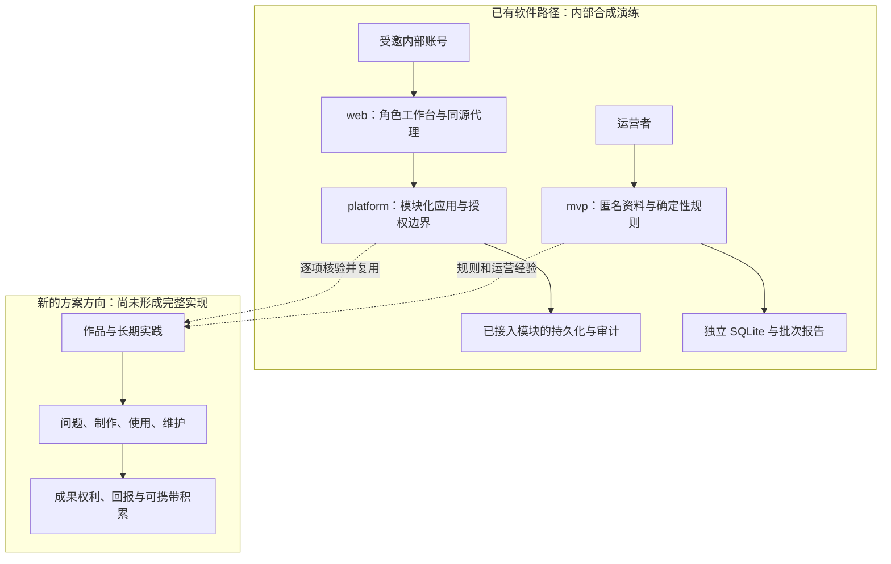

# 系统总览

愿作的新定位与整体结构以[《愿作整体方案报告：让人重新掌握完整创造》](/desire-supply-platform-design.md)为主。本页说明现有软件、人工服务与目标能力的边界，帮助技术合作者判断哪些可以复用、哪些需要继续验证和建设。

## 当前有两条实际软件路径

| 路径 | 当前作用 | 适用边界 |
| --- | --- | --- |
| `platform/` + `web/` | Python 模块化平台与 Web 工作台；已接入受邀账号、职责工作区、画像和需求编辑、审核、合成资金确认、匹配邀请与选择，以及限定范围的 Trust/Appeal | 当前为 `INTERNAL_SANDBOX`，用于内部账号与合成资料演练，不等于真人服务或生产交易已开放 |
| `mvp/` | 单运营者使用的本地 Python CLI；提供匿名资料校验、预算检查、可解释匹配、推荐与决定留痕、批次报告 | 保留独立的 SQLite、输入模型和配置；不是 Web 的后端，也不是当前仓库唯一入口 |

此外，`demo/` 是可重置的合成制度原型。它能演练比当前 Web 更完整的协议、交付、付款、申诉和数据权旅程；这些状态不能证明相应服务已经持久化、接入真实供应商或产生现实效果。

图中两条已有路径没有隐含数据同步关系。内部沙箱的已接入状态，也不把真实合同、资金或外部服务默认为可用。

## 当前平台的主链路与断点

现有 Web 的主要协作链路是：受邀登录与政策确认，选择服务端授权工作区，填写画像或需求，审核需求与合成资金依据，组织匹配，创作者响应邀请，需求方选择已接受的候选。发布、暂停、恢复、版本冲突、拒绝、撤回、操作留痕和部分异常恢复已进入相应实现。

**当前 Web 的项目协议、交付验收与结算尚未接入完整流程。** 其他上下文可能已有契约、领域代码或测试，但不能因为模块目录存在就算作用户已经可用。资金确认是沙箱合成语义；接受邀请不等于接受最终合同；匹配成功不等于作品交付或收入到账。Trust 与 Appeal 也应按当前对象和角色范围判断，不能据模块存在推断所有创作者争议均已覆盖。

当前运行入口见[内部试运行平台](/architecture/internal-pilot-platform.md)、[运行与逐步检查](/operations/run-and-check.md)和[本机 Docker 指南](/operations/docker-local.md)。数据库合同与恢复边界见[Current-head v30](/operations/current-head-v30.md)；静态校验、已装配能力、实际执行和现实效果是不同事实。

## 作品中心能力如何接续现有架构

新方案将委托、创作者发起、共同或公共创造连接到作品与长期实践。工程上需要在已有身份、版本、披露、匹配和保护机制之上，明确新的对象及授权，而不是直接把 Demand 或 Project 改名为作品。

| 新方案需要表达的内容 | 可复用基础 | 需要新增或核验的边界 |
| --- | --- | --- |
| 作品与长期实践 | 版本、审计、对象权限与当前协作模型 | 作品与一次委托、合同、交付和长期维护分别建模 |
| 创作者主动发起 | 个人账号、意愿与能力画像 | 个人发起、早期使用者、探索成本与支持安排；不强迫转成组织采购 |
| 使用反馈与后续决定 | 需求中的问题、验收及目标受益者信息 | 实际使用、受益者反馈与付款方验收分离，并确认参与者的决定权限 |
| 成果权利与可携带积累 | 同意、字段披露、版本证据等基础 | 署名、许可、复用、收益、第三方权利、导出与接收验证 |
| 持续经营和公共支持 | 已有资金、项目、安全和治理设计 | 持续服务、维护责任、支持条件与公共劳动报酬；现实主体和协议不能由代码代替 |

这些是待设计和验证的能力，尚不是已确定的数据库表、生产 API 或上线承诺。具体建设顺序遵循[Foundations 落地路线图](/foundations/realization-roadmap.md)及[工程演进路线](/development/roadmap.md)。

## 可继续深入的架构入口

- **身份、会话与前端**：[身份、租户与同意](/architecture/identity-tenancy-consent.md)、[Web BFF 与前端](/architecture/web-bff-and-frontend.md)、[生产组合与运行控制](/architecture/production-composition-and-operations.md)。
- **当前协作基础**：[Creator Profile](/architecture/creator-profile.md)、[Demand 生命周期](/architecture/demand-lifecycle.md)、[匹配邀请与选择](/architecture/matching-invitation-selection.md)、[Trust、争议与申诉](/architecture/trust-safety-dispute-review.md)。
- **后续闭环的既有设计**：[项目、协议与交付](/architecture/project-agreement-delivery.md)、[空间与文件](/architecture/workspace-and-files.md)、[资金与对账](/architecture/funding-and-payment-projection.md)、[数据权与清除](/architecture/data-rights-retention-and-erasure.md)、[受控 AI Gateway](/architecture/controlled-ai-gateway.md)、[共同体与治理](/architecture/community-governance.md)。
- **CLI 独立路径**：[当前 MVP 架构](/architecture/current-mvp.md)、[领域模型](/architecture/domain-model.md)、[匹配、预算与决策](/architecture/matching-and-budget.md)、[首批项目流程](/operations/pilot.md)。
- **整体技术设计参考**：[目标平台架构](/architecture/target-platform.md)、[平台领域模型](/architecture/platform-domain-model.md)、[项目结构](/development/project-structure.md)。

上述专题文档包含不同时间和交付层次的设计，应结合当前代码、装配与验证记录阅读；历史范围描述不能覆盖本页明确列出的两条现有路径，也不能把新的作品中心规划算作已经实现。

## 持续保留的架构约束

**明确权威事实。** 需求、邀请、协议、交付、验收、付款和实际受益各有来源；读模型、通知和分析不能反向伪造业务事实。重大决定需要负责的人与可追溯依据。

**权限与隐私随对象设计。** 当前 Web 由服务端决定工作区和对象能力；新的作品权限也要分清作者、协作者、使用者、付款方及维护者。CLI 继续只处理其允许的匿名结构资料，不能因平台已有身份能力而取消自身输入边界。

**可解释与可恢复。** 保留输入、规则、版本和人工决定的关联，处理重复请求、并发变化、结果未知及恢复。未来的携带能力还要证明接收后能使用，而不仅是导出成功。

**以最小可运行闭环推进。** 复用模块化平台和合适的外部工具，逐项补齐真实需要的纵向路径。是否拆分服务、引入新基础设施或建设通用创作工具，应由责任边界、容量和反复出现的问题决定。

新的架构方向不改变活动授权。真实研究、合同、资金和公开服务继续核对[启动决策入口](/foundations/readiness-and-start-decision.md)。设计、实现、启用与有效改善分别验收；发现文档和代码不一致时明确记录并修正，不用任一方自动覆盖另一方。
