# 愿作整体方案报告：让人重新掌握完整创造

> **Desire Supply · 整体方案 v2.1 · 2026 年 11 月 1 日**
>
> 面向创作者、场景伙伴、资源提供者、研究者与长期支持者的协作讨论报告。
>
> 本报告替代原《愿作平台设计》的总体定位与发展方向。方案、样本、周期与资源安排均为合作提案，不表示已获得伙伴、资金或上线能力。当前实现依据代码审查，见第十二节；真实研究与服务的启用条件继续由专项决策确认。

## 阅读导航

| 你希望了解什么 | 建议阅读 |
| --- | --- |
| 用几分钟判断是否值得参与 | 执行摘要、第一至三节、第十四节 |
| 了解参与者会经历什么 | 第四至七节 |
| 讨论成果权利、收入与组织方式 | 第八至十一节 |
| 比较各方现有选择、参与动机和经营可行性 | [商业可行性与利益相关方选择分析](/foundations/commercial-feasibility-and-stakeholder-choices.md) |
| 评估现有基础、投入与实施可行性 | 第十二至十五节 |
| 核对理论来源和实现依据 | 文末参考与相关文档 |

## 执行摘要

**愿作帮助个人和小型协作团队，发现值得解决的问题，掌握从构想到实际使用的创造过程，并获得可持续的收入、成果权利和社会联系。**

AI 正在扩大个人能够理解和完成的工作范围。过去需要多人分工的部分数字化产品，现在有机会由个人或小团队贯穿研究、设计、制作和维护。OPC（一人公司）是这种变化的一种组织表达，独立创作、合作团队、共同工具与公共知识也值得支持。

生产能力提高之后，仍有一段重要距离需要跨越：人能否决定自己做什么，能否接触实际使用者，能否获得探索和维护所需资源，能否保留合理成果权利，能否在不失去全部积累的情况下拒绝、暂停和离开。

愿作要建设支撑这些条件的协作网络。它以**作品与长期实践**为中心，连接问题、创作者、使用者、资金、专业服务与共同知识。公平撮合是获得合作的一条路径，作品可以跨越多次交易，持续积累版本、关系和价值。

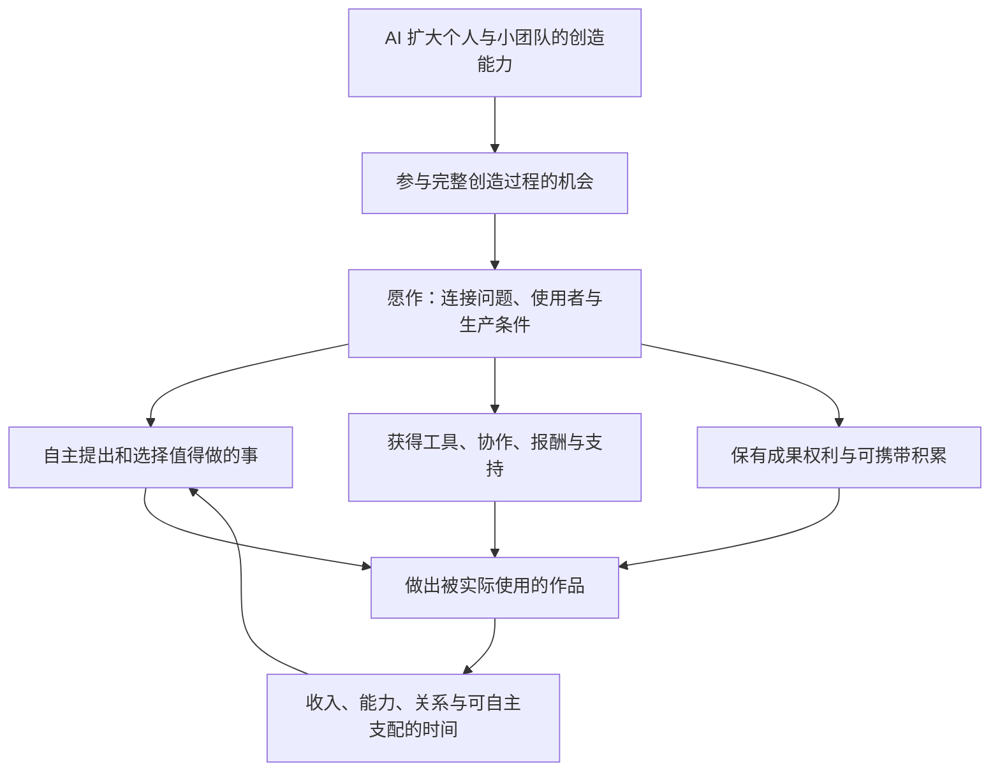

**图 1｜愿作希望形成的正向循环。** 生产率提升只有转化为人的选择空间和可持续生活，才完成本方案关心的价值传递。

已有基础包括意愿与能力画像、劳动边界过滤、可解释匹配、双向邀请、需求审核，以及身份、隐私和审计机制。当前软件仍是内部合成沙箱，协议、交付验收、真实结算和完整作品生命周期尚未形成可用闭环。

下一步建议在一个低风险领域验证两条路径：**共同定义的委托创作**与**创作者发起的作品**。先寻找愿意共同提供问题、使用反馈、专业支持和有边界资源投入的伙伴，完成最小完整创造循环，再讨论扩大规模。

商业上先聚焦一个重复问题域，提供可独立购买的诊断、可交接改进与有限维护，优先验证委托方是否愿意为减少管理负担和更适用的成果付费。创作者发起的作品按独立资源开放。平台要比较现成工具、直接合作与既有供应商，只有确有增量价值时才介入；详见[商业可行性分析](/foundations/commercial-feasibility-and-stakeholder-choices.md)。

我们希望得到的第一批支持，是明确的场景联系人、负责任的协调者、付费探索与维护预算、可调用的专业能力，以及愿意共同复盘成功和失败的合作者。每一份支持都应明确用途、期限、条件和退出安排。

## 一、我们希望改变的处境

### 1.1 从局部劳动重新连接完整成果

分工提高效率，也可能使人只接触生产链中的狭窄片段。他知道自己交付了什么，却不一定知道问题为何值得解决、成果如何被使用，也未必能够影响后续发展。

马克思在《资本论》中分析了工场手工业如何将劳动者固定为局部职能；《1844 年经济学哲学手稿》进一步讨论了劳动者与产品、劳动活动及他人的异化关系。这提醒我们：自豪感的减少往往与实际关系有关，包括目标由谁决定、劳动如何组织、成果由谁支配，而不仅是缺少鼓励。[来源 1](https://www.marxists.org/archive/marx/works/1867-c1/ch14.htm)、[来源 2](https://www.marxists.org/archive/marx/works/1844/manuscripts/labour.htm)

愿作把这一视角转化为可讨论、可验证的设计问题，不以产品功能宣称已经解决社会层面的异化。

| 参与者可能经历的困难 | 希望提供的条件 | 可观察的变化 |
| --- | --- | --- |
| 只能执行别人预先定义的任务 | 提出问题、共同确定目标与修改方案 | 实际影响过重要决定 |
| 看不见成果被谁使用 | 接触实际使用者，获得经同意的反馈 | 能说明成果为谁产生了什么作用 |
| 劳动结束后没有自己的积累 | 明确署名、许可、复用、贡献证明与维护知识 | 项目后仍有可继续发展的资产 |
| 因收入压力接受不合理条件 | 有报酬探索、明确付款责任、变更协商和补救 | 拒绝、退出与失败不被转化为额外惩罚 |
| 一个人承担全部技术与经营工作 | 可选择的小团队、专业服务与有报酬互助 | 主导整体时仍能获得必要帮助 |
| 离开平台就失去关系与证明 | 适当的数据与成果携带、工具兼容与迁移 | 能在平台之外继续自己的实践 |

### 1.2 自主不要求每个人单干

完整创造意味着理解整体、参与关键决定，并知道自己与成果之间的关系。一个人可以亲手做完，也可以选择协作、委托专业环节或共同维护。

愿作应容纳独立创作者、临时小队、稳定团队、公共项目和有明确范围的普通委托。是否成立公司、融资或扩大组织，由参与者根据需要决定。

工作也不必始终充满热情。完成一项普通工作、获得合理报酬并安心休息，同样值得保护。

## 二、为什么现在值得尝试

AI 为部分研究、写作、设计、编程与运营任务提供了新的辅助方式，使个人有机会跨越原来难以独立完成的环节。不同领域的能力、质量与责任差异很大，实体生产、专业判断和长期运维仍需要相应资源与专业参与。

OPC 已进入公共政策与创业服务讨论。例如深圳的 2026—2027 年行动计划，将支持延伸至空间、人才、工具、场景和公共服务，体现了小规模生产组织对配套条件的需要。具体政策适用性需另行确认。[来源 3](https://www.sz.gov.cn/cn/xxgk/zfxxgj/tzgg/content/post_12602687.html)

愿作提出一个待验证假设：**当制作能力更容易获得时，问题发现、可信关系、成果权利、风险分担和持续维护，会成为决定个人能否长期创造的重要条件。**

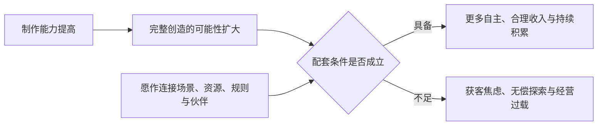

**图 2｜机会与风险同时存在。** 平台要验证怎样改善配套条件，而不把更高产量本身视为成功。

## 三、使命与整体结构

### 3.1 六项需要同时关注的条件

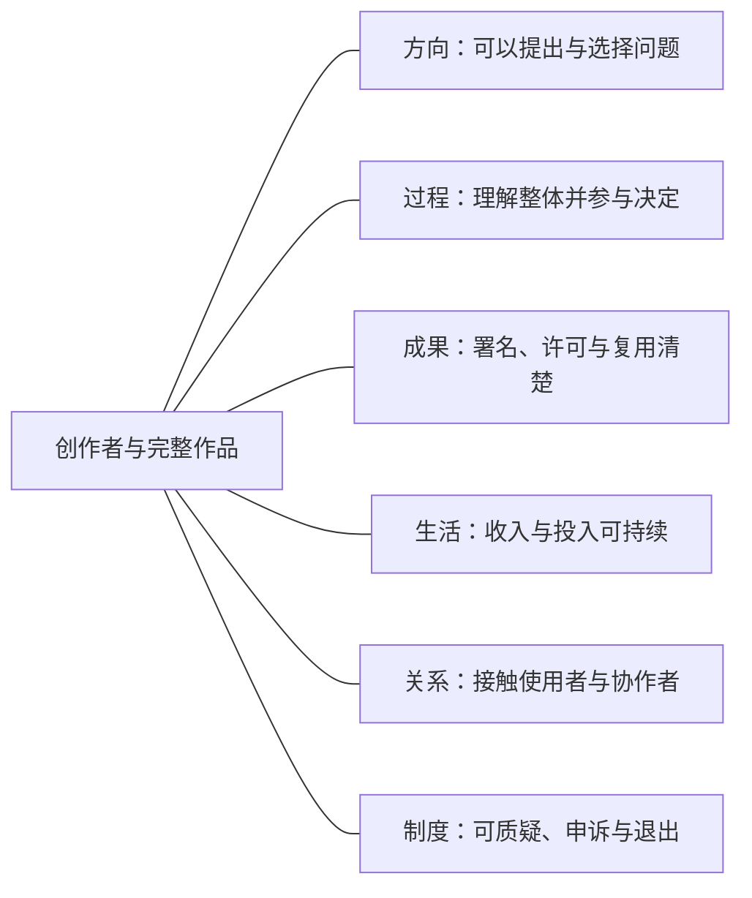

**图 3｜评价平台的六个方面。** 它们共同构成判断框架，不合成为一个人的“自主分数”。

愿作的长期价值，在于帮助参与者逐渐拥有更多方向选择、可靠关系、可复用成果和替代路径。平台需要保持自身可持续，同时让参与者具备离开平台继续发展的能力。

### 3.2 以作品连接多种合作

“作品”是本方案的中心概念，指持续回应真实需要、能够留下成果与责任记录的创造过程。它可以表现为产品、工具、内容、研究、设计、课程材料或持续服务。这里的作品是产品规划概念，不自动等同于法律上的著作权客体。

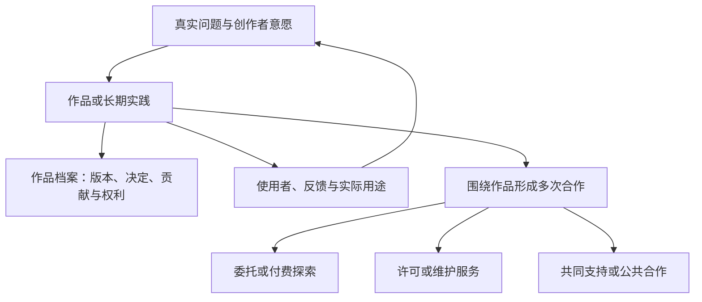

**图 4｜作品跨越单次交易。** 一笔订单结束后，版本、关系和权利安排仍能延续；具体续作需要重新确认参与与条件。

## 四、参与者如何走完一次完整创造

### 4.1 三种来源，两条优先验证的路径

| 路径 | 从哪里开始 | 怎样形成合作 | 验证顺序 |
| --- | --- | --- | --- |
| A：共同定义的委托创作 | 组织或个人提出真实需要 | 使用者与创作者共同澄清问题，约定探索、成果与报酬 | 第一批优先 |
| B：创作者发起的作品 | 创作者提出问题或实践方向 | 找到愿意试用和共同定义问题的人，形成支持、采购或许可安排 | 第一批优先 |
| C：共同需求与公共创造 | 多个主体发现共同问题 | 汇集场景与资源，协商共同成果、访问方式和维护责任 | 多方责任可承载后扩展 |

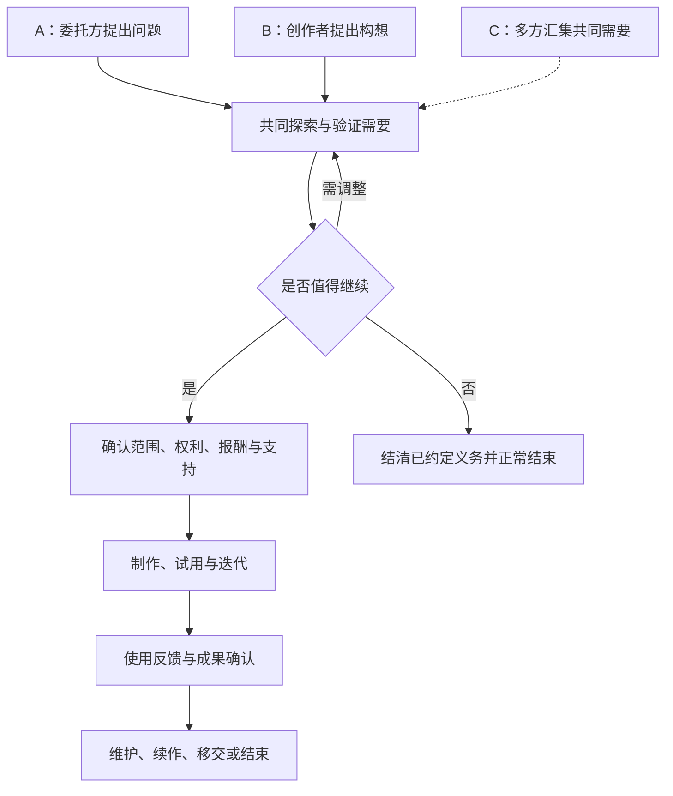

**图 5｜三种来源进入同一创造循环。** 虚线表示较后扩展的路径。发现不值得继续，也是探索的有效结果。

创作者可以先保存自己的问题或构想，不必先具备采购预算。对外要求他人投入实质劳动时，必须说明报酬、支持与风险。个人自愿探索与客户要求的试做，应分别处理。

### 4.2 生命周期中的决定与责任

| 阶段 | 需要回答的问题 | 应留下的最小记录 |
| --- | --- | --- |
| 发起 | 为什么想做？谁可能需要？ | 问题、意愿、已有证据与未知事项 |
| 探索 | 问题是否真实？有哪些替代办法？ | 使用反馈、试验结果、已约定探索报酬 |
| 约定 | 谁决定什么？各方投入与权利是什么？ | 范围、验收、报酬、署名许可、退出安排 |
| 制作 | 怎样完成？哪些判断必须由人作出？ | 版本、关键决定、验证结果、贡献与变更 |
| 使用 | 是否可用？对实际使用者有何作用？ | 合同验收与使用反馈两类独立记录 |
| 延续 | 维护、发展、移交还是结束？ | 维护责任、持续成本、权利与迁移资料 |

记录帮助理解与协作。平台不应要求持续监控屏幕、按键或所有 AI 对话来证明劳动，也不应把记录变成新的绩效负担。

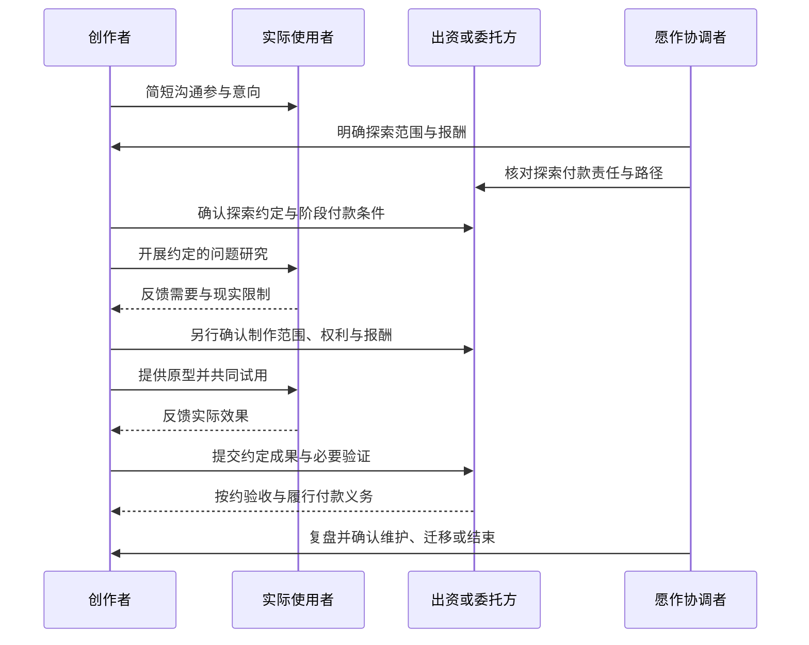

**图 6｜一次合作中的主要交流。** 实质探索先约定报酬，付款义务按探索、制作和维护阶段分别履行，末端付款并非唯一付款时点。使用者、付款者和验收者可能不同；图示不表示愿作代收或托管资金。

## 五、一个具体的参与情景

以下是假设案例，不是已发生项目。

一位创作者发现，小型文化社团在整理活动资料和交接工作时经常重复劳动。他希望制作一个简单工具。社团负责人愿意提供场景，使用者包括资料整理人员和下一届接手的人。

愿作帮助他们安排有明确范围的探索：重复劳动发生在哪里、现有工具为何不够、哪些资料可以使用、原型需要验证什么。创作者保留提出替代方案和停止无效方向的空间。

探索后，双方约定制作与维护：社团获得满足用途的使用权，创作者保留事先约定的通用组件复用权；社团资料保持受限。协作者提供有报酬的设计或安全评议。实际使用一段时间后，再决定是否续作。

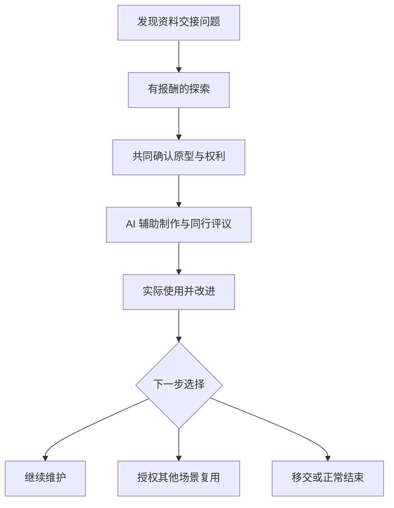

**图 7｜一件作品的多种合理后续。** 商业化、扩张与持续维护，都应依据实际使用、参与意愿与资源条件决定。

案例的关键结果包括：创作者理解问题，参与重要设计，得到使用反馈，获得约定报酬，并留下明确可继续使用的积累。

## 六、伙伴如何共同参与

### 6.1 角色围绕具体事项形成

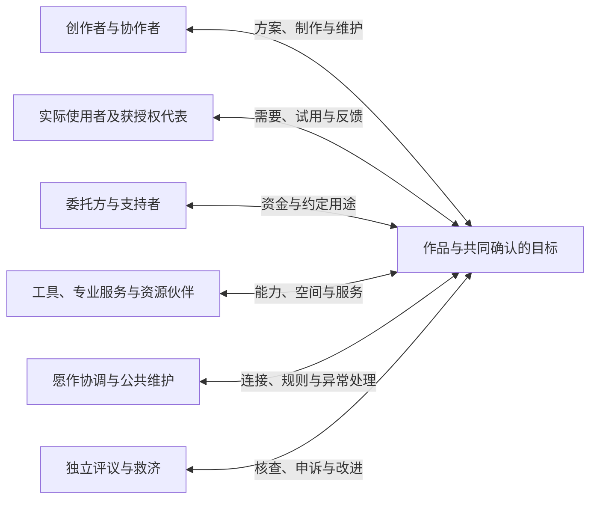

**图 8｜围绕作品形成的合作网络。** 每种角色都应有明确作用域和责任；出资或提供资源不自动获得其他角色的权力。

| 参与者 | 可以贡献什么 | 应当获得什么 | 需要明确的边界 |
| --- | --- | --- | --- |
| 创作者 | 问题意识、专业判断、制作与维护 | 报酬、成长、约定权利与可见贡献 | 范围、节奏、选择与退出 |
| 实际使用者 | 真实情境、试用与反馈 | 有用、可理解、可维护的成果 | 同意、隐私与参与负担 |
| 委托或采购方 | 需要、预算、输入与验收责任 | 约定成果与可靠协作 | 不事后扩大范围或改写权利 |
| 学校、社区、机构或园区 | 场景联系、空间、设备与专业网络 | 可核验的场景改善和学习成果 | 不以学业、雇佣或服务关系强迫参与 |
| 工具和专业服务伙伴 | 模型、开发设计工具、专业支持 | 透明服务回报与经授权案例反馈 | 成本、数据、供应商替换与终止 |
| 资金支持者 | 探索、维护、公共能力和风险准备资源 | 用途透明、阶段证据与责任报告 | 不以资助换取综合控制或排他归属 |
| 愿作团队 | 协作、规则、运营与产品支持 | 合理服务收入与持续运行条件 | 对权力、费用和失败承担责任 |

### 6.2 一份支持应怎样落地

用一张简明协作卡确认：资源是什么、由谁实际提供、支持谁和什么目标、可用期限、费用与附带条件、涉及的数据和成果权利、停止条件、替代方案、负责联系人。

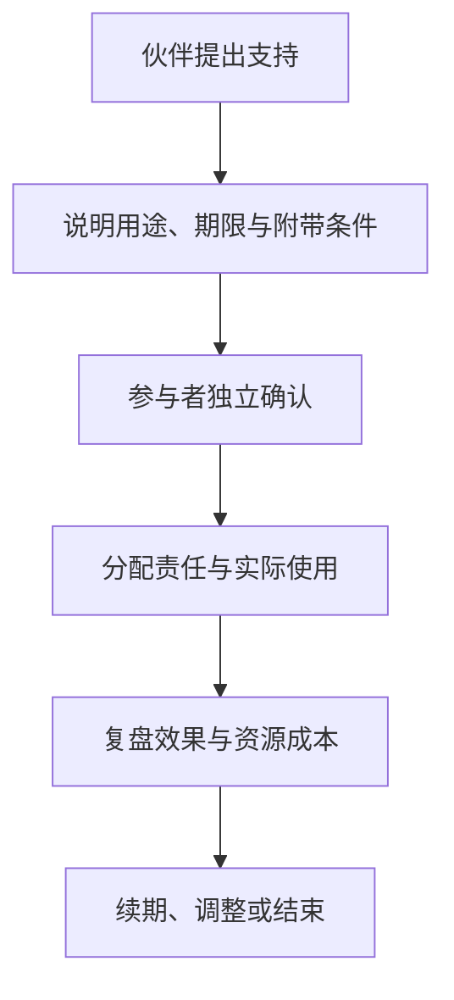

**图 9｜资源协作的最小流程。** 支持终止应按其自身关系善后，不应无关连带取消账户、应得报酬或申诉渠道。

## 七、平台需要补齐的核心能力

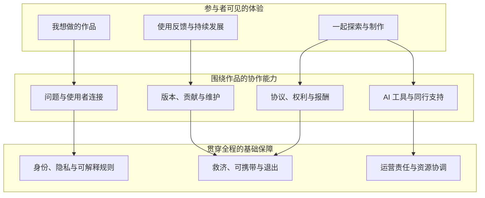

**图 10｜目标能力结构。** 这是产品规划图，不是当前软件架构或已上线功能清单。

| 能力 | 最小可验证形态 | 当前基础与变化 | 优先级 |
| --- | --- | --- | --- |
| 创作者发起 | 问题或作品卡，可寻找使用者与支持 | 从画像和受邀响应扩展到提出方向 | 首个循环 |
| 有报酬探索 | 独立约定范围、报酬与停止条件 | 将澄清原则变成创作者可用的阶段 | 首个循环 |
| 完整作品记录 | 关联问题、版本、决定、反馈与维护 | 从单次需求和项目延伸为长期对象 | 首个循环 |
| 权利与收益协商 | 可理解的署名、许可、复用、维护和报酬选择 | 将协议设计变为可操作关系 | 首个循环 |
| 使用者反馈 | 合同验收之外的使用确认 | 将受益者参与前置到探索与迭代 | 首个循环 |
| 创作者救济 | 可达的举报、申诉与退出路径 | 补齐角色入口及后台责任 | 真实参与前必要 |
| 工具连接与迁移 | 接入已有工具，导出获授权成果和说明 | 保证过程连续，不先重建所有工具 | 首个循环与后续深化 |
| 有报酬互助 | 具名导师、评议者与小队协作约定 | 提取可人工验证的支持服务 | 按需要纳入 |
| 共同需求与公共维护 | 多方确认用途、权利和维护资金 | 在责任能力基础上扩展多方关系 | 后续阶段 |

优先级由完整旅程中的必要性决定。第一版可以由人工服务与已有工具承载部分环节，但必须让参与者经历完整循环；界面占位不能替代实际服务。

## 八、作品权利与收益怎样安排

### 8.1 每次合作都应讲清楚的权利

| 事项 | 需要确认的内容 |
| --- | --- |
| 署名与贡献 | 谁做了什么，如何确认共同贡献，哪些贡献可以公开 |
| 展示与证明 | 是否可进入作品集、出具合作证明，敏感部分怎样处理 |
| 使用与修改 | 谁在什么场景使用、修改和维护，是否有限期或范围 |
| 复用与许可 | 通用工具、既有材料和新成果分别如何复用与授权 |
| 商业与公共用途 | 许可、买断、共同持有、开放发布如何选择和定价 |
| 后续收入与责任 | 若约定持续收益，如何计算、核验、支付并匹配责任 |
| 停止与迁移 | 未完成成果如何处理，谁维护，哪些资料可以带走 |

权利应依据实际来源与适用规则确认。不能凭上传、贡献记录或“AI 生成”标记，推断某一方拥有全部权利。开放许可、买断和共同所有应是清楚协商后的结果。

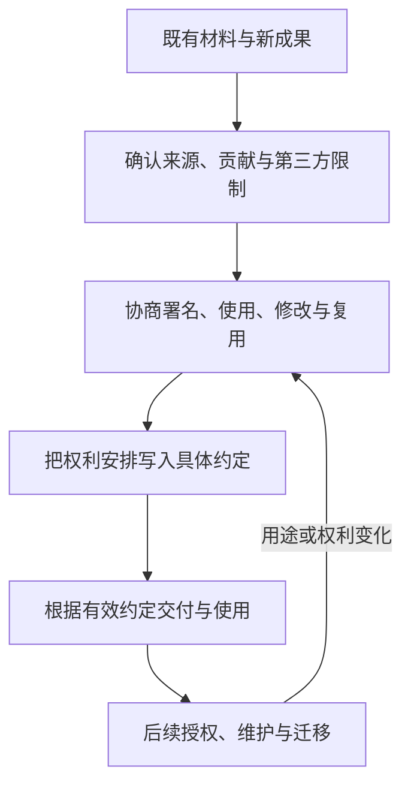

**图 11｜权利贯穿成果生命周期。** 平台保存约定与证据，实际权利仍需由有权主体作出有效安排。

### 8.2 让效率收益进入人的生活

报价应考虑成果价值、投入、直接成本、风险与后续责任。AI 节省时间可以支持更合理收入、休息、学习和探索，不应自动转化为更低报价或更多无偿任务。

评估可持续回报时，要同时看收入、工具、获客、沟通、返工、维护成本与实际投入。私密报酬底线用于保护参与者，不能成为压价信息。

低于个人边界的例外，应由本人逐案、清楚且可拒绝地确认。平台或出资方的批准不能代替个人同意，也不能通过失去无关支持制造压力。

## 九、经济模式与资源如何可持续

### 9.1 三类资金用途分别核算

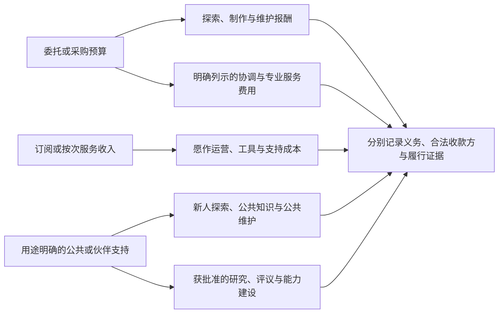

**图 12｜候选资金用途。** 箭头表示经济用途，不表示资金统一进入愿作账户。收付、税费、结算与退款路径必须逐笔确定。

候选收入包括需求澄清与协调、维护支持、组织采购服务，以及参与者自愿选择的工具或专业服务。收费方、价格和支付意愿需要验证。受限资助、创作者报酬和平台收入必须分开。

平台不能靠出售个人数据、购买排名、隐藏费用或限制退出维持经营。也应持续检查对单一客户、资助方、模型或场景节点的依赖。

### 9.2 将公共劳动纳入成本

新人指导、同行评议、调解、资料整理和规则维护，都消耗真实时间。发生这些工作时，应说明责任、范围、报酬或明确自愿安排，检查是否由少数人长期承担。

公共贡献不应成为普通创作者获得有偿机会的隐性门票。暂时没有余力贡献的人，也应得到正常参与机会。

### 9.3 按工作包形成预算

| 工作包 | 估算依据 | 明确产出 |
| --- | --- | --- |
| 场景发现与研究 | 场景数、研究工时与参与补偿 | 问题证据、反馈与范围判断 |
| 探索与制作 | 逐作品约定的阶段报酬 | 探索结果、原型、成果与验证 |
| 维护与退出 | 维护窗口、支持责任与移交工作量 | 持续使用或正常结束 |
| 协调、评议与救济 | 批次容量、异常与响应安排 | 有责任人的协作与补救 |
| 工具与基础设施 | 实际用量与报价 | 可用且可替换的制作条件 |
| 法律、财务与数据准备 | 项目范围与启用义务 | 可执行约定与受控路径 |
| 公共沉淀与独立复盘 | 获授权案例整理和维护工时 | 可复用知识与阶段判断 |

批次预算应覆盖已承诺义务、维护、失败善后与风险准备。补救储备不能被当作新增项目的自由资金。正式金额、承担主体与拨付条件，在伙伴与范围明确后逐项确认；本报告不虚构已获投资或资金缺口数字。

## 十、AI 怎样参与完整创造

AI 可以辅助资料研究、方案形成、原型制作、内容与代码生成、问题检查和维护说明。愿作应帮助人选择工具、理解结果、控制成本并保留替代路径。

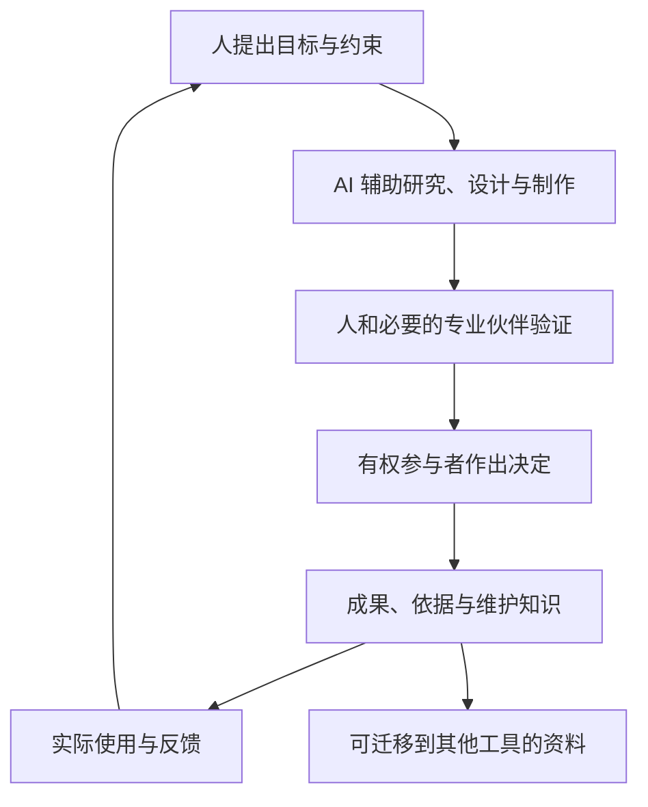

**图 13｜保持人对过程的理解和控制。** 付款、处罚、争议裁决与权利授权等决定，需要明确的责任主体和程序。

第一阶段连接已有工具，优先确认数据用途、费用、导出、版本留存与供应商替换，无需重建通用模型或完整开发环境。

同时关注能力成长：创作者能否解释关键选择、发现错误、进行必要修改，并知道何时需要专业协助。AI 生成更多成果，不能直接等同于人的能力提高。

## 十一、共同体、治理与退出

### 11.1 让支持关系有限且可问责

人可以同时参与学校、机构、其他平台和多个专业网络。愿作提供的资源与归属，不应要求唯一身份、排他忠诚或放弃权利。

治理随真实合作关系发展。早期先落实公开规则、资产与控制关系登记、利益冲突披露、独立救济和规则改变的回应责任。随着成员与公共资产形成，再建立适合的代表与共同所有安排。

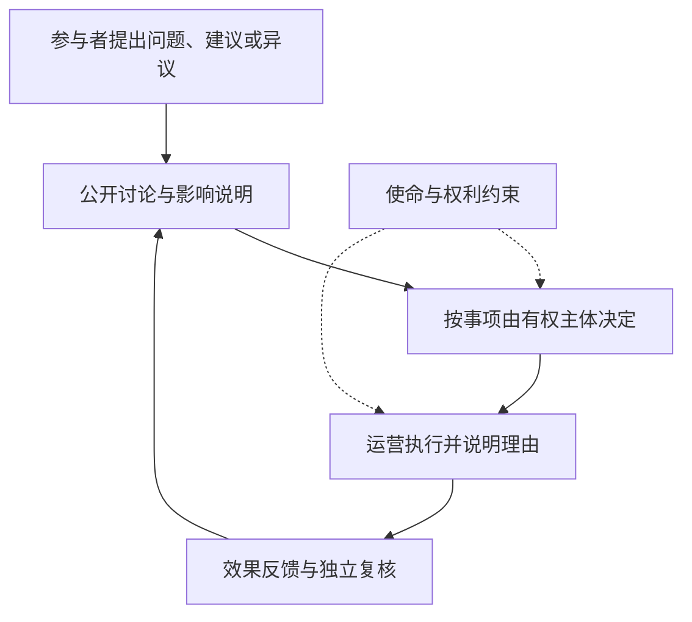

**图 14｜从异议到规则改进。** 治理需要真实授权与执行责任；投票页面本身不能建立共同主权。

成员、运营团队、支持者和投资者分别拥有什么权利，需要通过适用的组织与合同安排确定。资本可以获得事先约定的合理回报，资源投入不能自动购买成员资格、私密数据或规则的单方控制。

### 11.2 正常退出也是成功路径

退出安排覆盖应得报酬、未完成义务、资料携带、作品许可、维护交接和申诉。携带范围应尊重合作方隐私、保密义务与第三方权利；数据导出不意味着获得所有资料的使用权。

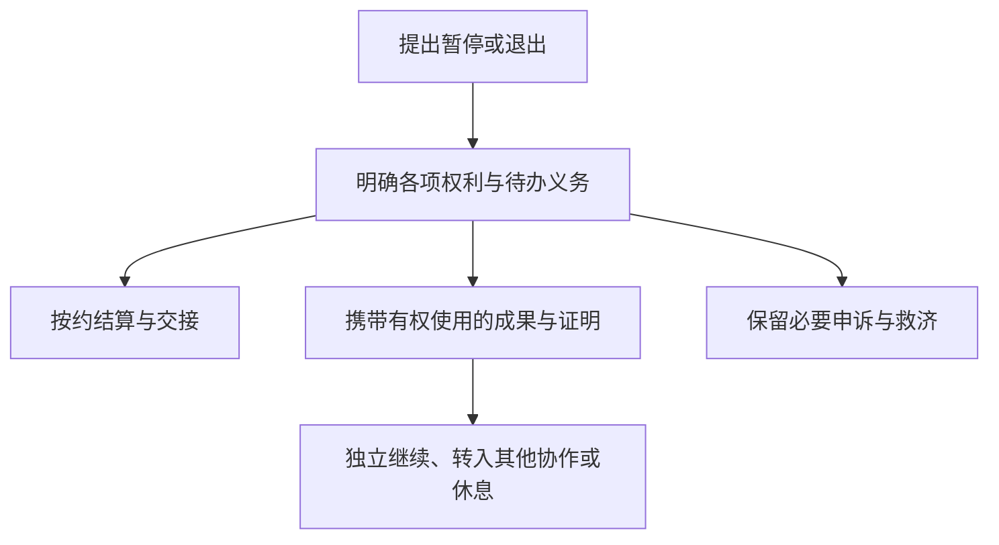

**图 15｜让离开成为可完成的过程。** 各项义务依法律与有效约定分别处理，不因无关结算争议阻断已有携带和救济权；平台不以维持依赖作为留存手段。

## 十二、现有基础与需要跨越的差距

以下是截至本报告日期的仓库静态审查，不是生产运行认证或真实效果评估。`platform/` 与 `web/` 有实际多角色内部工作台；`mvp/` 保留单运营者 CLI；`demo/` 的合成演示不代表正式功能已经实现。

| 方面 | 当前事实 | 对新方案的意义 |
| --- | --- | --- |
| 身份与工作台 | 有受邀账号、工作区、权限、会话和服务端流程 | 可复用的参与与责任基础 |
| 意愿与边界 | 有兴趣、时间、合作、私密底线与禁止领域等资料及过滤 | 已将部分个人意愿写入实际机制 |
| 双向选择 | 有邀请接受、拒绝、选择前撤回与画像暂停 | 部分劳动开始前的选择权 |
| 需求与匹配 | 有结构化需求、审核、匹配、邀请与选择 | 委托来源与合作连接基础 |
| 资金 | 双人核验仅使用零真实资金的合成凭据 | 尚不能证明真实付款保障 |
| 项目与交付 | 有项目壳原型；运行路径的协议、交付验收与结算未接通 | 最小完整循环的关键缺口 |
| 申诉与保护 | Trust、Appeal 有实现；创作者前端入口有缺口 | 真实参与前需补齐可达性与责任 |
| 作品、AI 创造与治理 | 完整作品、生产工具连接、成果携带与成员共治未成闭环 | 主要产品与制度工作 |

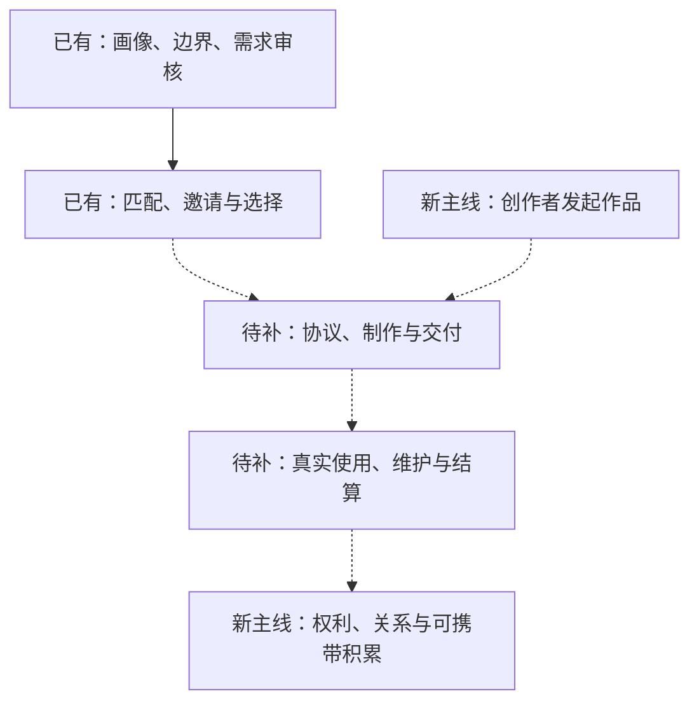

**图 16｜已有基础与下一阶段重点。** “已有”均限内部合成沙箱；虚线所示能力尚需建设与实际验证。

本次审查基于仓库修订 `1b9151a`。关键依据：[画像模型](https://github.com/BillShiyaoZhang/desire-supply/blob/1b9151a/platform/src/desire_platform/creator_profile/domain/model.py#L866)、[匹配引擎](https://github.com/BillShiyaoZhang/desire-supply/blob/1b9151a/platform/src/desire_platform/matching/engine_v1.py#L686)、[邀请状态机](https://github.com/BillShiyaoZhang/desire-supply/blob/1b9151a/platform/src/desire_platform/matching/domain/model.py#L563)、[前端角色入口](https://github.com/BillShiyaoZhang/desire-supply/blob/1b9151a/web/app/product-client.tsx#L2958)、[运行时间线](https://github.com/BillShiyaoZhang/desire-supply/blob/1b9151a/platform/src/desire_platform/internal_pilot/admin_demand_timeline.py#L435)、[项目壳原型](https://github.com/BillShiyaoZhang/desire-supply/blob/1b9151a/platform/src/desire_platform/coordination/complete_selection.py#L570)、[资金约束](https://github.com/BillShiyaoZhang/desire-supply/blob/1b9151a/platform/src/desire_platform/internal_pilot/finance_funding.py#L192)、[部署边界](https://github.com/BillShiyaoZhang/desire-supply/blob/1b9151a/platform/src/desire_platform/internal_pilot/deployment_config.py#L280)。

当前最有依据的判断是：已有部分劳动选择与程序保护，完整创造、持续收益与实质共同控制仍需验证。新报告改变战略方向，不自动改变沙箱、数据与资金启用状态。

## 十三、分阶段实施与验证

R0—R3 表示新的合作与产品路线，与既有研究、生产和真实服务启用门槛分开。时间与数量是资源讨论的候选值，不是已确定排期或招募承诺。

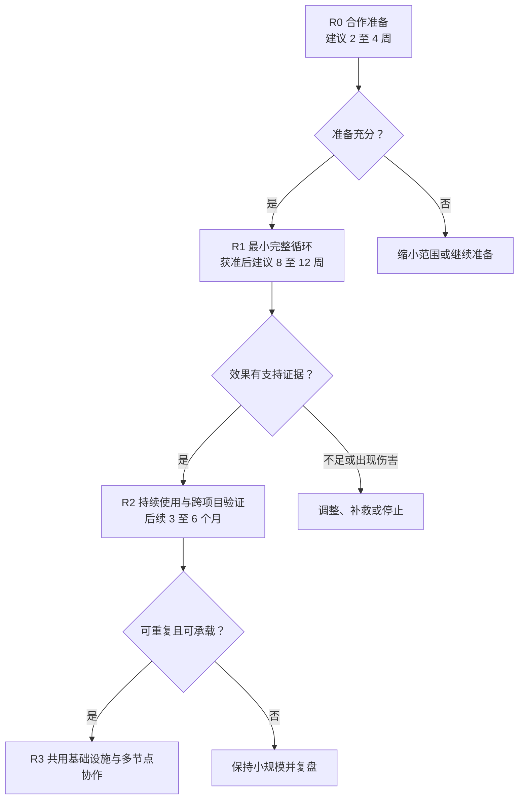

**图 17｜每一阶段都允许调整和停止。** 日期从相应条件具备后起算，随资源与证据修订。

### R0：形成可执行的伙伴协作方案

建议用 2—4 周完成内部与合成情景工作：明确一个低风险领域、候选场景与使用者类型、两条路径、角色责任、预算工作包与未知事项。外部研究条件未具备时，先用公开资料和合成情景，不直接招募真人。

产出一份批次说明：为什么做、如何判断有效、谁承担什么、最多承诺多少、怎样退出。明确责任人与资源路径后，再进入执行。

### R1：验证最小完整创造循环

在适用研究与真实服务条件满足后，建议用 8—12 周，在同一低风险领域先验证 3—4 项 A 路径作品；独立探索资源与使用反馈条件落实后，再加入最多 2 项 B 路径作品，总上限 6 项。按[商业可行性分析](/foundations/commercial-feasibility-and-stakeholder-choices.md)区分购买验证和自主探索支持，不要求两类样本均分或凑满数量；这不代表统计代表性。

每项作品走过探索、约定、制作、使用反馈与后续安排。部分环节可由人工服务与外部工具承载，但要记录实际成本。每条路径都应检查方向调整、条件拒绝和正常结束的可达性，不能为完成率回避这些情况。

进入时，以自愿且必要的记录了解参与者原有工作方式、可支配决定、收入与负担；结束后按同一问题回访。同时检查哪些变化也可能通过直接使用已有 AI 工具或其他协作渠道实现，避免把全部改善归因于愿作。

### R2：检查持续价值与跨项目积累

后续 3—6 个月跟踪使用、维护负担、收入与权利，结合交付后 30／90 天回访。检查是否产生经授权复用、创作者是否拥有更多选择、使用者能否承接必要维护。

复用次数不能直接当作成功。商业化、公开分享和跨场景复制都需满足原约定与实际需要。

### R3：扩展共用基础设施

多批次出现稳定需要与可靠责任主体后，再扩展共同需求、多方支持、公共维护资源、领域社区与跨节点协作。成员治理和共同所有随实际资产、成员关系与法律结构发展，不提前给出规模或完成日期。

## 十四、我们希望获得哪些协助

### 14.1 首批合作邀请

| 希望连接的伙伴 | 共同做的第一件事 | 需要的具体条件 | 可共同检验的价值 |
| --- | --- | --- | --- |
| 场景伙伴 | 选择一个持续存在的小问题 | 具名联系人、必要输入、获授权使用反馈 | 适合实际使用的成果与维护安排 |
| 创作者与小团队 | 提出愿意长期理解的问题或作品方向 | 时间、能力、边界与真实意愿 | 报酬、能力和成果积累 |
| 协调与运营伙伴 | 陪同跑通一个完整循环 | 案件容量、响应和异常处理责任 | 可复用协作方法与服务能力 |
| 工具与专业伙伴 | 支持一个制作或验证环节 | 工具额度或报价、专业工时与数据条件 | 经授权场景反馈和服务改进 |
| 研究与评议伙伴 | 共定问题并检查反例 | 研究设计、独立评议与隐私能力 | 有边界、可复核的实践知识 |
| 资金与公共资源伙伴 | 支持明确的探索与维护工作包 | 上限、用途、期限、停止与善后条件 | 用途透明、阶段成果与公共价值证据 |

合作不要求一次承诺全部资源。伙伴可先承担一个明确工作包，复盘后再决定是否继续。

伙伴选择愿作的理由不能只有价值认同。买方需要可用且可交接的结果，创作者需要扣除全部投入后更好的回报，渠道需要可承担的责任与明确服务价值。各方替代方案、拒绝理由与最小合作请求见[商业可行性分析](/foundations/commercial-feasibility-and-stakeholder-choices.md)。

### 14.2 组织责任应有人承担

首批至少覆盖方案与作品协调、场景联系与研究、技术与工具支持、运营与财务责任、独立评议及救济。部分职责可兼任，但原决定与独立申诉复核、资金操作与独立核验等应分开。

具体人力按可承担工时与批次容量安排，不预设已有专职团队。无法保障支持、维护与补救时，应降低并行作品数量。

### 14.3 一次伙伴讨论应形成的结果

1. 选择值得探索的问题，以及能够接触的实际使用情境。
2. 明确各方可以提供什么、不能承担什么、资源附带哪些条件。
3. 选择 A 或 B 路径，说明成果权利与后续使用的初步预期。
4. 形成工作包、责任人、预算上限、检查点和停止安排。
5. 列出需继续核实的事实，由明确的人负责取得证据。

## 十五、如何判断是否值得继续

### 15.1 用事实与参与者叙事共同判断

| 方面 | 要回答的问题 | 主要证据 | 需要警惕的误判 |
| --- | --- | --- | --- |
| 方向自主 | 是否参与目标设定并改变过重要方案 | 问题与方案版本、双方回放 | 点击同意被当成实质参与 |
| 整体理解 | 能否解释需要、主要结构与关键判断 | 演示、维护说明、理解访谈 | AI 产出多被当成能力增长 |
| 成果联系 | 是否被使用，能否获得必要反馈 | 试用与后续使用记录 | 付款者满意被当成受益 |
| 权利积累 | 结束后实际保留什么权利和材料 | 有效约定、可用导出与复用实例 | 下载按钮被当成可继续经营 |
| 经济可持续 | 扣除成本后报酬是否合理，负担能否承担 | 付款事实、自愿投入记录与维护成本 | 交易额掩盖无偿劳动 |
| 关系与退出 | 是否自愿继续，退出能否完成善后 | 独立反馈、退出与申诉案例 | 高留存掩盖依赖与压力 |
| 公共价值 | 互助、知识与工具是否被复用和维护 | 获授权使用、公共工作与补偿记录 | 发帖量替代实际用途 |

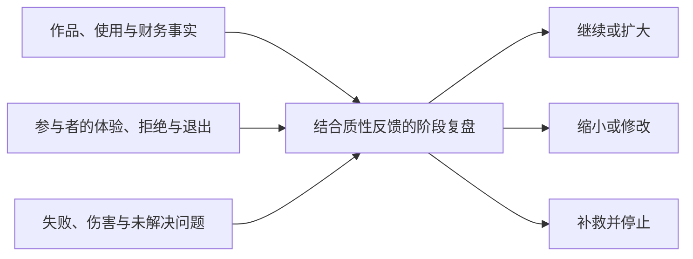

**图 18｜复盘必须保留失败与反例。** 小样本只能支持具体机制的有限判断，不能证明普遍消除异化或获得长期生计保障。

### 15.2 主要风险与行动

| 风险 | 早期信号 | 应采取的行动 |
| --- | --- | --- |
| 独立经营过载 | 获客、沟通、工具和维护挤占全部时间 | 缩小范围、提供支持、核算隐形劳动 |
| 热情被无偿使用 | 反复要求免费试做、指导或公共维护 | 明确工作包和报酬，停止无边界要求 |
| 使用价值不足 | 原型完成却无人持续使用 | 回到探索，允许结束 |
| 资源购买控制 | 要求排他、无关数据或干预救济 | 重新协商或终止，准备替代路径 |
| 平台或模型依赖 | 换工具或退出后无法继续 | 验证导出、替代工具与交接 |
| 权利与维护悬空 | 复用不清、无人承担后续支持 | 继续投入前补齐约定与预算 |
| 运营能力不足 | 付款、支持或申诉无法按约处理 | 停止新增承诺，完成现有义务 |

第一批最有价值的证据，是参与者能够具体说明：通过愿作，自己多决定了什么、多理解了什么、看见谁在使用成果、获得哪些合理回报，以及留下什么可以继续发展的积累。

## 参考与相关文档

- 商业判断：[商业可行性与利益相关方选择分析](/foundations/commercial-feasibility-and-stakeholder-choices.md)，包含各方替代方案、服务调整、三方经济测算与验证安排。
- 马克思：[《资本论》第一卷，分工与工场手工业](https://www.marxists.org/archive/marx/works/1867-c1/ch14.htm)；[《1844 年经济学哲学手稿》，异化劳动](https://www.marxists.org/archive/marx/works/1844/manuscripts/labour.htm)。本报告将相关问题转译为产品与组织假设，不以引用替代效果证据。
- 深圳市工业和信息化局：[《深圳市打造人工智能 OPC 创业生态引领地行动计划（2026—2027 年）》](https://www.sz.gov.cn/cn/xxgk/zfxxgj/tzgg/content/post_12602687.html)，2026 年 1 月。用于说明公共讨论，不表示本项目已获得政策支持。
- 价值与制度：[社会契约](/foundations/social-contract.md)、[经济宪法与治理结构](/foundations/economic-constitution.md)、[成员制度与开放共同体](/foundations/membership-and-open-community.md)。
- 方案细化：[产品与首批试点定义](/foundations/product-and-pilot-definition.md)、[落地路线图](/foundations/realization-roadmap.md)、[研究与证据计划](/foundations/research-and-evidence-plan.md)、[使命衡量与学习计划](/foundations/mission-measurement-and-learning-plan.md)、[经营与资源计划](/foundations/business-finance-and-go-to-market.md)。
- 当前实现：[内部试运行平台](/architecture/internal-pilot-platform.md)、[运行与检查](/operations/run-and-check.md)、[管理员需求全流程](/operations/admin-demand-timeline.md)。
- 真实研究与服务启用：[统一就绪度与决策入口](/foundations/readiness-and-start-decision.md)。本报告替代旧总体定位；历史记录、机器契约与既有启用事实继续按各自范围解释。
