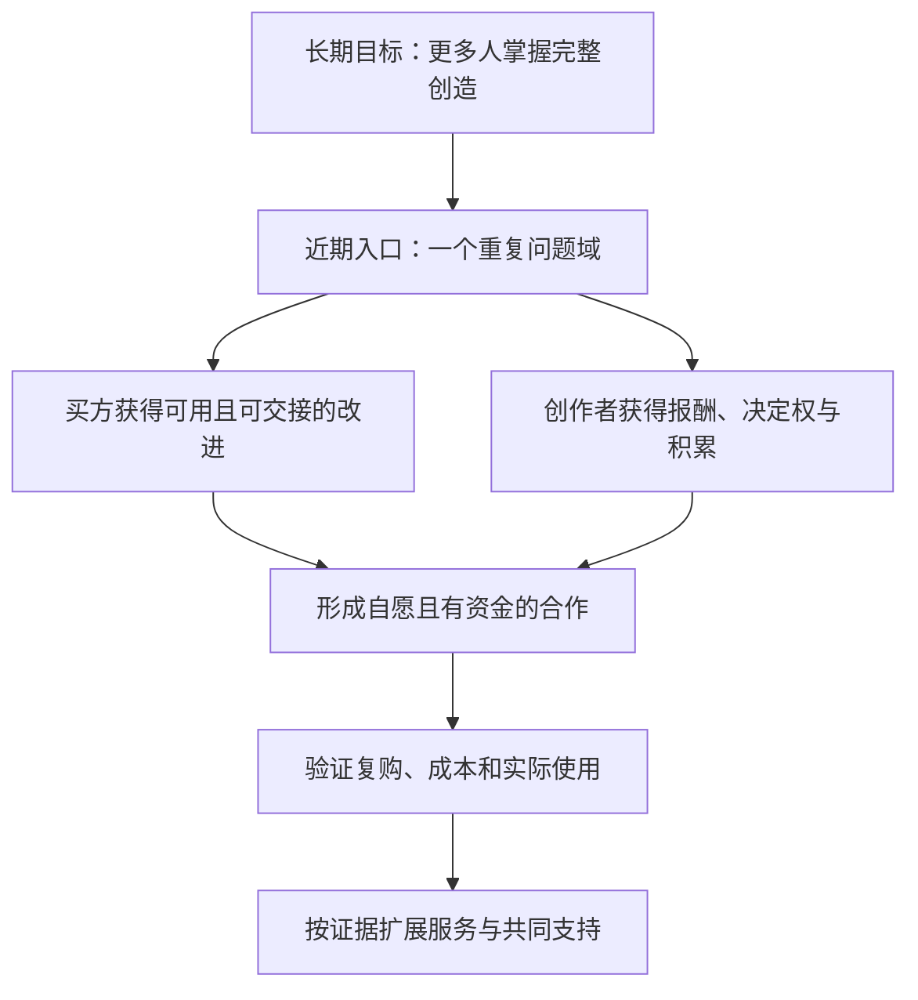
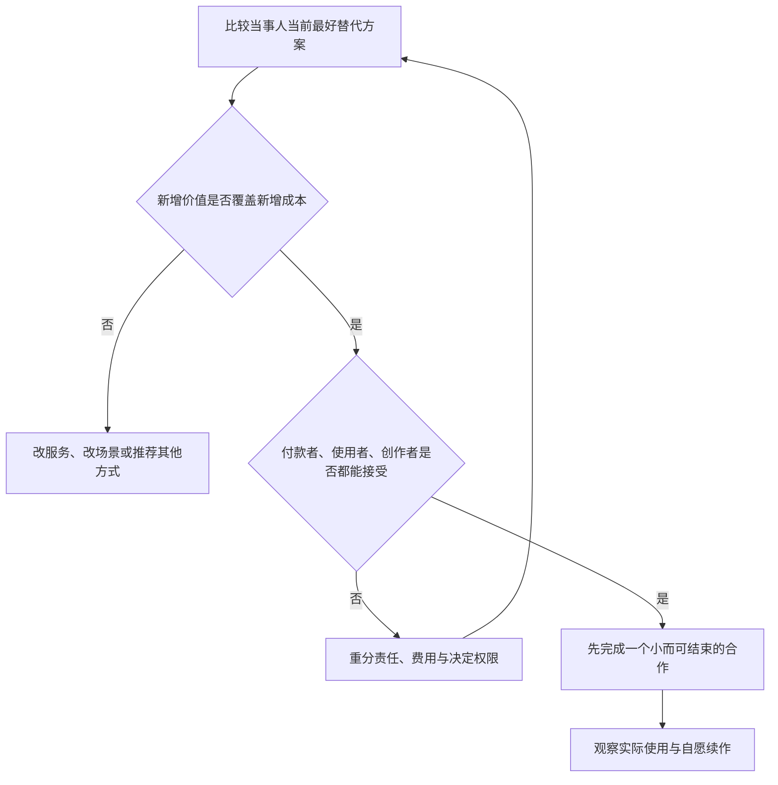
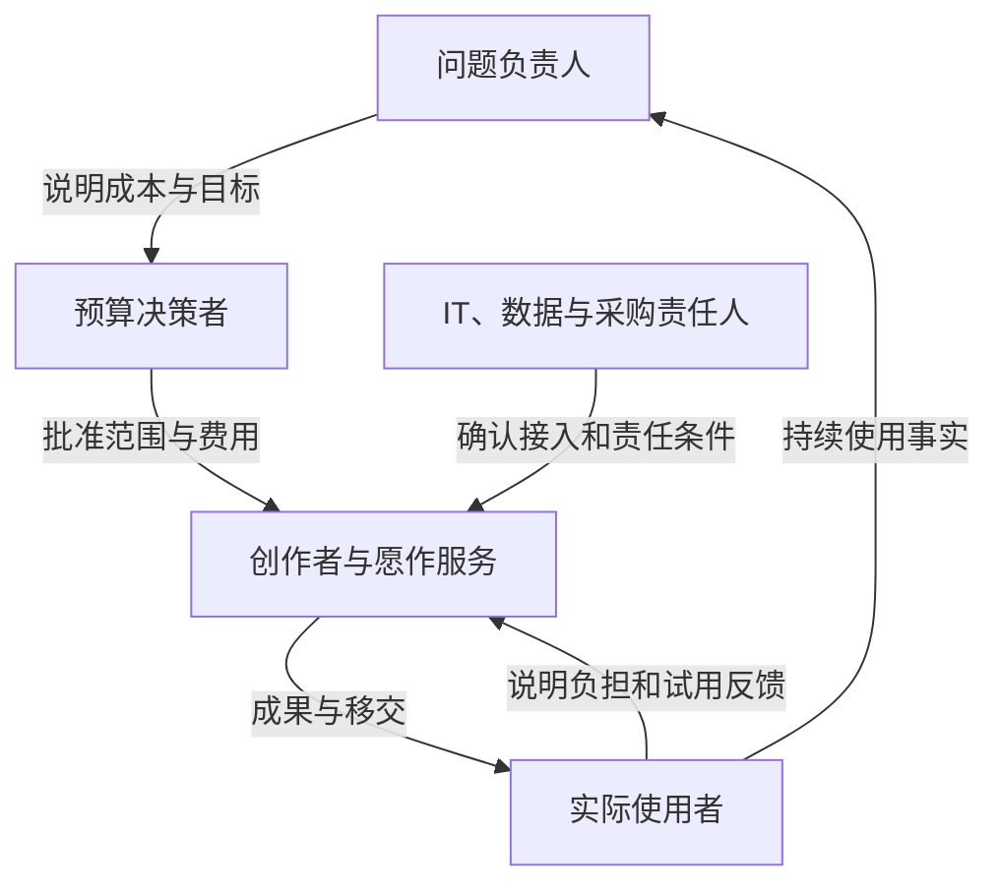
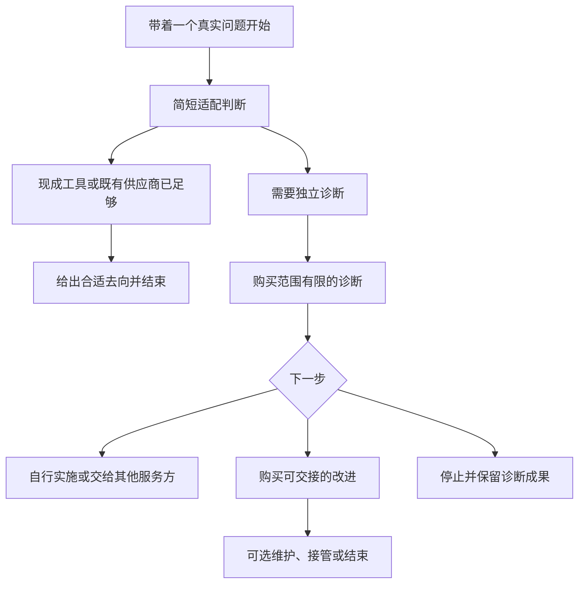
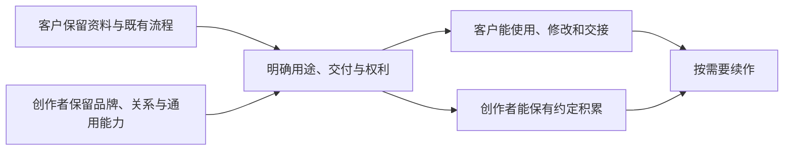
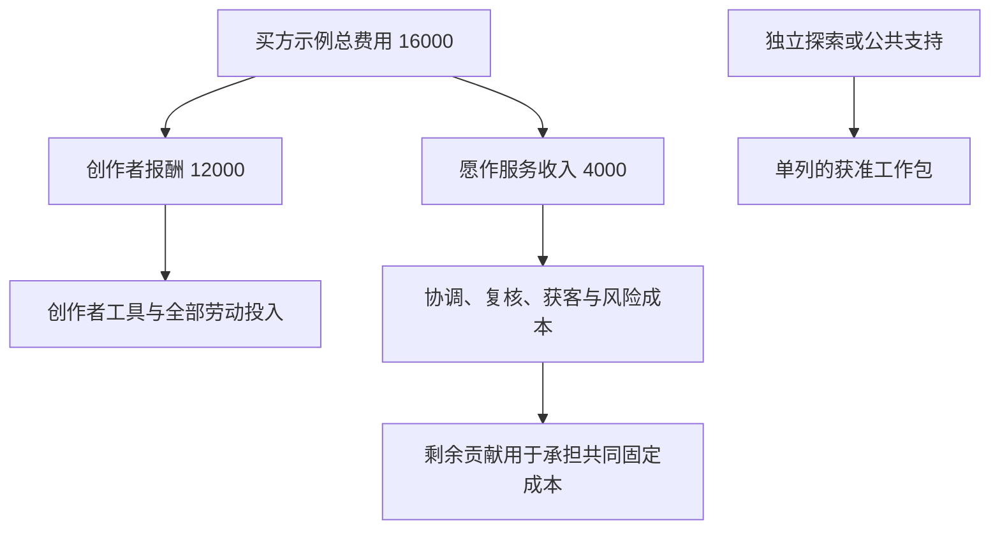
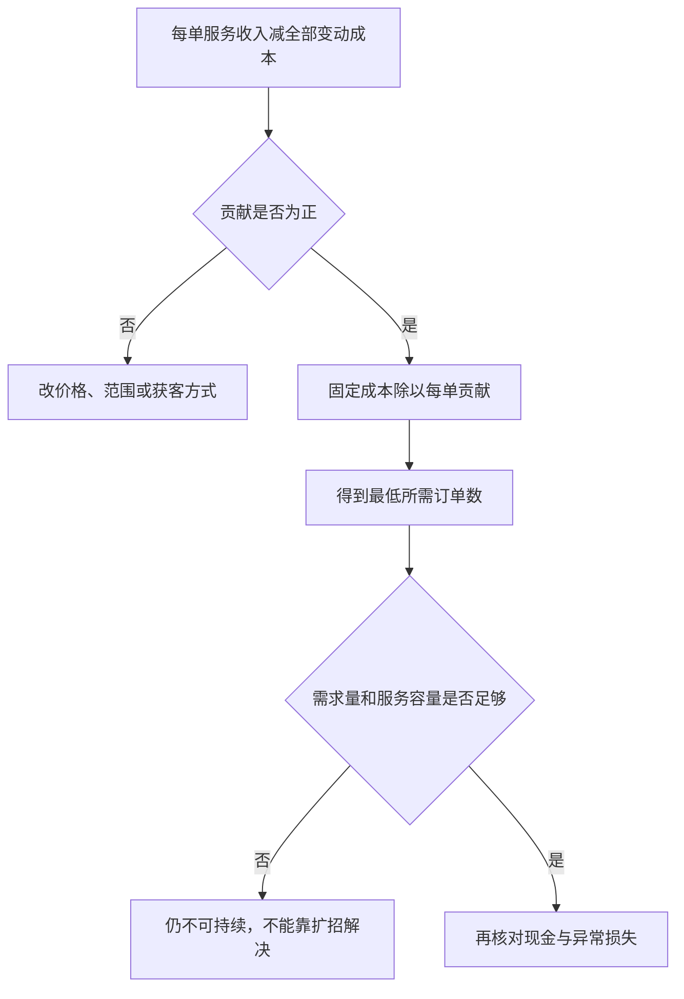
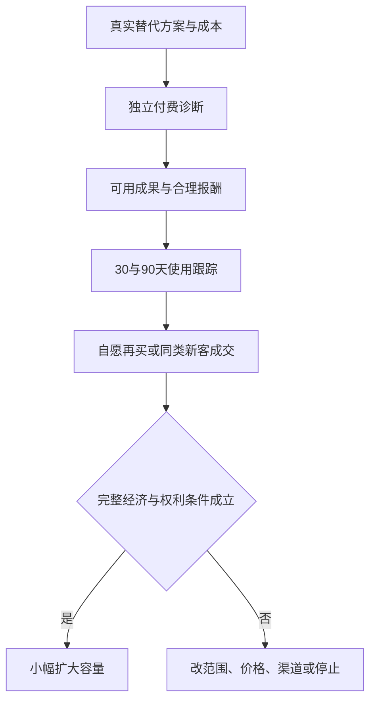

# 愿作商业可行性与利益相关方选择分析

> 合作讨论稿 v1.0 · 2026-11-01
>
> 本文回答谁会选择愿作、为什么愿意付出成本，以及怎样使合作比现有办法更划算、更容易开始。结合[整体方案](/desire-supply-platform-design.md)、现有实现与公开替代服务分析；参与动机和经营结果仍需真实行为验证。文中的金额、工时和试点数量均为明确标记的测算假设或候选安排，不是市场报价、已获资源或收入预测。

## 一 商业判断

**愿作有机会成为一个窄领域里有持续收入的协作服务，但目前不足以证明一个面向所有创作者的综合平台能够商业成立。** 现方案明确了参与者应该获得什么，却没有充分说明他们为什么要放弃熟悉的工具、关系和采购方式，额外承担愿作的费用与流程。

对买方而言，创作者的自主与自豪感通常不是直接采购理由。可购买的价值是少走弯路、少花管理精力、得到能用且能交接的成果。对创作者而言，完整创造需要转化为更可靠的报酬、更少的无偿获客和返工、可实际使用的权利。对伙伴而言，参与必须有明确产出、成本上限和责任，不能只靠价值认同维持。

建议将商业切入收窄为：**帮助已经有具体问题和预算的小型组织，在现有工具上完成一次可使用、可交接的改进；让有交付能力的独立创作者主导方案，愿作承担双方愿意付费购买的判断、协调和复核服务。** 可以使用客户已有的创作者，也可以使用创作者已有的客户。是否需要重新撮合，应由实际缺口决定。

| 判断对象 | 当前结论 | 改善方向 |
| --- | --- | --- |
| 广泛双边撮合市场 | 尚无需求密度、稳定供给或获客成本证据 | 先通过已有关系处理少量付费问题 |
| 有边界的委托服务 | 值得验证，但协调费必须创造增量价值 | 聚焦重复场景、固定服务包和有限责任 |
| 创作者自主作品 | 有使命价值，不能默认客户会为探索买单 | 明确购买者，或使用独立落实的探索预算 |
| 工具与会员订阅 | 当前缺少必须另付费的独立价值 | 暂缓通用订阅，先验证按次服务和维护 |
| 公共资源与资助 | 可以支持商业市场不覆盖的活动 | 与客户购买分开核算，安排到期后的责任 |
| 大规模资本扩张 | 现阶段与高人工服务、有限收费存在张力 | 先证明重复购买与完整成本后的经营能力 |



**图 1｜商业入口服务于长期目标。** 先证明一个合作关系能够持续，再增加参与者和服务种类。

## 二 怎样判断一种选择更好

每一方都拥有退出选项。比较对象应是他真正能够采用的最好办法，包括保持现状，而不是假设中的最差供应商。

```text
某一方选择愿作的增量利益
= 相比其最好替代方案增加的收益与权利
+ 减少的时间、支出和可验证风险
− 新增费用、学习、协作、迁移与退出负担
```

非货币利益不能随意折算为金额。收入、时间、成果权利、组织责任和个人意愿要分别判断；没有必要编造一个综合分数。企业节省的时间也不一定变成现金：只有能够重新用于有价值工作，或实际减少支出时，才有相应经营意义。

**总收益增加，不代表每个人都愿意加入。** 老板受益但使用者增加录入，平台收入增加但创作者承担无限维护，伙伴获得案例但基层人员被迫配合，都可能使合作失败。



**图 2｜低阻力来自可接受的分配与有限承诺。** 降低表单和迁移负担有用，但不能消除真实的利益冲突。

## 三 谁决定购买 谁承担成本

| 利益相关方 | 最希望获得 | 有吸引力的现有选择 | 可能拒绝愿作的原因 | 愿作必须证明 |
| --- | --- | --- | --- | --- |
| 问题负责人 | 问题解决、少协调、交付可解释 | 熟人供应商、内部同事、现成工具 | 多一个需要管理的中间人 | 承担了原本由他完成的具体工作 |
| 预算与采购决策者 | 预算可控、责任明确、结果可交代 | 已准入供应商、成熟软件、暂缓 | 新主体、新合同、新费用，失败责任分散 | 小额独立服务也有可验收产出 |
| 实际使用者 | 少重复劳动、容易学、故障有退路 | 原有表格、群聊、手工流程 | 多录入、多测试、被监控或承担故障 | 净工作负担下降且能影响方案 |
| 能独立交付的创作者 | 有效机会、合理净收入、专业自主 | 直接接单、熟客、工作室、雇佣 | 平台增加记录、沟通与隐形劳动 | 扣除全部投入后仍优于其现实选择 |
| 新进入者与自主作品发起者 | 学习、作品、使用反馈与探索资源 | 个人探索、课程、开源、孵化 | 被当成廉价供给、只获曝光无报酬 | 有边界的支持与真实反馈，收入不虚诺 |
| 专业协作者与导师 | 有偿专业工作、清楚责任 | 自营咨询、培训、机构项目 | 零散免费求助、无限背书与担责 | 可拒绝、可报价、责任范围有限 |
| 工作室与渠道机构 | 服务收入、客户满意、成员价值 | 自行交付、转介、既有合作网络 | 客户被转走、利润被压缩、声誉受损 | 补充其缺失能力且保留合理关系 |
| 工具与资源供应商 | 持续付费使用、反馈、低支持成本 | 直销、自有生态、其他渠道 | 只有免费额度消耗，没有转化 | 可归因的使用和有限服务成本 |
| 资助方与公共伙伴 | 特定公共产出、预算用途与可问责结果 | 资助其他项目、自营服务、公共采购 | 难验收、长期无资金、只报活跃人数 | 明确受益、完整成本、维护和停止安排 |
| 愿作运营团队与出资者 | 能支付人工、承担风险、保有现金 | 咨询工作室、软件服务、其他投资 | 收费低但承诺广、人工随订单线性增长 | 贡献与容量同时成立，资金义务可履行 |

这些角色不等于需要十个不同的人。小组织可以兼任，但应分别确认预算、验收、使用和数据权限。内部 IT、财务和实际使用团队即使不付款，也可能否决上线或在实际工作中绕开新流程。

| 谁可以拒绝什么 | 对合作的影响 | 应怎样处理 |
| --- | --- | --- |
| 预算或采购责任人拒绝支出与签约 | 无权启动该项采购 | 缩小为独立诊断、换适用预算，或停止；问题提出者不能代批 |
| IT 或数据责任人拒绝接入与使用资料 | 原方案不能按该条件执行 | 在既有边界内改方案，或由有权主体确认新条件 |
| 个人拒绝研究、公开案例或额外参与 | 相关活动不能靠机构同意代替 | 保留普通服务与其他适当参与方式，不惩罚拒绝 |
| 使用者不实际采用 | 即使合同验收，效果仍不成立 | 回访负担与适配问题；这属于采用事实，不自动等于其拥有组织采购否决权 |
| 创作者拒绝范围、价格或权利条件 | 不能把邀请视为接受 | 重议条件、寻找自愿合作者或结束 |



**图 3｜付款不是唯一的采用条件。** 先确认这些角色的实际联系，能够减少后期反复审批和无法使用的交付。

## 四 各方的替代方式与选择条件

### 4.1 买方会在什么情况下付费

| 方式 | 获得的利益 | 承担的成本与风险 | 哪些情况下应优先选择它 |
| --- | --- | --- | --- |
| 不做或继续手工 | 无采购、学习和迁移支出 | 重复劳动和错误继续存在 | 低频问题，改善收益低于改变成本 |
| 自己用 AI、模板或低代码工具 | 启动快，直接控制，可能现金支出较低 | 自己判断需求、验证、学习与维护 | 模板已经满足需要，团队有人能负责 |
| 内部同事完成 | 熟悉流程和责任，资料无须增加外部接触 | 占用内部时间，可能缺专长 | 有能力、有空余，且不是短期孤立需求 |
| 熟人或既有供应商 | 已有信任与采购习惯，沟通直接 | 可能缺替补、评议或维护安排 | 合作稳定且当前缺口已被覆盖 |
| 工作室或集成商 | 可以购买较完整的交付与持续责任 | 价格、准入和流程需具体比较 | 多系统、长期支持、复杂责任的项目 |
| 通用人才市场 | 候选范围大，可以比较专业能力 | 客户仍需定义问题、选人和管理 | 客户有足够项目管理能力 |
| 愿作有限服务 | 有偿诊断、具体协调、专业复核与交接 | 新服务费和配合成本，早期信任不足 | 问题重复、范围有限，现成办法缺最后一段落地支持 |

愿作不能把“AI 制作”和“有里程碑”当作独有能力。飞书已公开展示多维表格、审批与模板组合的业务流程方案；这证明现成工具值得先比较，不证明它在具体客户处的收益。Upwork 已有服务费及付款保护相关服务，说明单纯“增加交易保障”也并非空白市场。[飞书官方方案](https://www.feishu.cn/content/article/7586978539782556871)、[Upwork 服务费说明](https://support.upwork.com/hc/en-us/articles/211062538-Learn-about-the-Freelancer-Service-Fee)

**愿作应愿意给出“不需要定制”的结论。** 付费诊断的独立产出应是现状与问题证据、可选办法、必要验证、实施或停止建议。客户即使不继续，也能拿着这些材料自行处理或交给其他供应商；后续制作费另行确认，避免把诊断变成购买大项目的门票。

买方还需要一个明确联系人，但单一联系人不等于愿作已经承担总包责任。报价必须写明谁对诊断、制作、复核、故障处理负责。若买方要求一个主体承担整体结果，应由有能力的交付方另行报价和承担责任；只收协调费的愿作不能口头承诺全面兜底。

### 4.2 实际使用者为什么愿意配合

使用者的基准通常是熟悉的现有流程。管理者觉得先进，不代表使用者愿意改变。

| 变化 | 对使用者的可能好处 | 可能产生的阻力 | 服务设计调整 |
| --- | --- | --- | --- |
| 自动整理或提醒 | 少做重复搬运、查找和催办 | 错误提醒、重复录入、解释成本 | 先改一个步骤，比较净节省时间 |
| 新工具和新界面 | 信息更清楚，交接更方便 | 学习、账户和流程切换 | 优先使用现有工具，保留回退流程 |
| 试用与反馈 | 能改变真正影响自己的设计 | 被当作免费测试人员 | 约定时间与任务，纳入工作安排或补偿 |
| 更透明的过程记录 | 责任清楚、成果可见 | 被用于额外监控、评价或压缩岗位 | 明确数据用途，拒绝借项目扩大无关监控 |

愿作能承诺的是自身服务与记录的边界，不能代替雇主保证岗位或劳动待遇。若组织希望以降低人力成本获益，相关影响必须明说并纳入实际采用判断，不能以“所有人都受益”掩盖。

### 4.3 创作者为什么愿意加入

| 方式 | 主要利益 | 主要代价 | 愿作相对优势成立的条件 |
| --- | --- | --- | --- |
| 稳定雇佣或长期团队 | 收入和支持相对连续，经营任务较少 | 方向、时间和成果安排受组织约束 | 只适合本人愿意接受经营不确定性的阶段性或独立合作 |
| 熟客直接合作 | 无额外平台流程，可保留关系和品牌 | 自担合同、回款、备援 | 存在其愿意购买的具体缺口；否则直接合作更优 |
| 自营获客接单 | 自主选客、报价和经营 | 销售、试作、沟通、返工与催款 | 愿作真实减少这些无偿时间并提供合格需求 |
| 通用接单平台 | 更多可发现机会和已有交易服务 | 规则、竞争、费用与适用条件 | 愿作在具体场景质量和净收益上更合适 |
| 进入工作室 | 有项目和专业支持，个人少经营 | 对客户和作品的主导程度需协商 | 愿作能提供必要支持而不要求全面从属 |
| 自主产品、开源或孵化 | 更大方向空间、可能形成长期资产 | 需求与收入不确定，持续经营压力大 | 有独立探索资源和真实使用者；不拿未来收入抵当前劳动 |

最值得优先邀请的，是**已有交付能力，但不想独自承担全部获客、范围管理和维护协调的人**。最愿意报名的新手不一定能构成可靠供给。新人支持应设置独立预算、导师报酬和适合的任务，不能通过低价主创岗位让客户或新人承担未经说明的学习风险。

创作者需要在接受前看到问题、报酬、付款责任、修改边界、时间与权利。选择适合的人，可以先核验已有作品，再开展有偿探索；不要让多位候选人免费做可用原型。

“不从创作者报酬中抽费”也不能单独证明更公平。买方总预算固定时，额外服务费同样可能挤压制作预算。必须比较最终净收入、全部投入时间和双方获得的价值。

### 4.4 工作室与渠道伙伴为什么愿意带来业务

| 伙伴 | 可以独立采用的方式 | 参与愿作需要获得的增量 | 最小合作方式 |
| --- | --- | --- | --- |
| 有客户的工作室或咨询者 | 自行交付、分包、雇人 | 补足能力或溢出产能，降低交接成本 | 联合交付一个明确工作包，保留原客户联系 |
| 专业协会或社群 | 内部转介、活动、培训 | 成员得到可信机会，投诉责任可控 | 自愿转介一项符合条件的问题，不排他 |
| 园区或孵化机构 | 空间、讲座、竞赛、既有企业服务 | 能展示实际使用与经营改善的服务成果 | 购买有限诊断或试点服务，并预先确认验收 |
| 学校或研究机构 | 课程、实习、课题或自有孵化 | 真实场景与可研究的实践成果 | 自愿研究或专项支持，研究预算与交易分开 |
| 社区或公益机构 | 志愿服务、公共采购、既有工具 | 实际受益、有人维护、风险可承担 | 先确认支持主体，再开展一个可结束的改善 |

伙伴不应同时被要求提供客户、导师、资金、免费运营和长期维护。第一次合作只需一个可结束的承诺。合理的转介或交付费用要对应实际服务、公开计入成本，并处理利益冲突；支付转介费不能购买候选选择权或默认披露成员资料。

如果机构考核只接受注册公司数或融资额，而愿作坚持普通创作也有价值，这是真实的不适配。可以寻找不同预算和部门，不能把短期作品包装成创业成功去满足报表。

### 4.5 工具与专业服务伙伴为什么投入

工具供应商已有直销、订阅和合作渠道。愿作需要带来可归因的自愿付费使用、降低支持成本，或提供经同意且有用的场景反馈。只有免费额度消耗，对方没有持续合作理由。

初期按正常客户采购往往比要求“战略免费支持”更简单。资源赞助可作为有期限的额外支持，须同时列出到期后的正常价格与替代路径。创作者不购买指定工具也应能获得机会；不能向工具方承诺转售客户数据或独占创作者。

导师、评议者和接管维护者同样需要报酬与责任边界。可以购买一次限定范围的评议，不应把其姓名变成对全部交付质量的无限背书。

### 4.6 资助方与商业资本为什么参与

| 资金来源 | 合理利益诉求 | 其他选择 | 愿作有吸引力的条件 |
| --- | --- | --- | --- |
| 客户采购 | 获得适用成果与服务 | 自营、软件、供应商 | 具体服务值得支付自身预算 |
| 园区或机构服务采购 | 服务对象获得可核验结果 | 培训、活动、既有服务商 | 验收关注持续使用与改善，费用和责任清楚 |
| 公益或公共资助 | 支持市场未覆盖的人与公共成果 | 资助其他组织、公共服务 | 公共产出、受益者、维护成本和授权可说明 |
| 工具赞助 | 增加真实采用或产品学习 | 自有营销和生态项目 | 合理的获取成本、有限责任、可结束支持 |
| 创始人或耐心资金 | 验证使命与可持续服务 | 其他经营或投资方式 | 有封顶预算、证据里程碑与退出成本 |
| 追求快速扩张的股权资本 | 大规模收入、增长和投资退出 | 更易规模化的软件或市场平台 | 未来有足够标准化、低边际成本与增长证据；当前尚不充分 |

深圳的 OPC 行动计划确实涵盖空间、工具成本、场景对接和公共服务，说明可以寻找已有生态中的合作位置。但政策文本不等于本项目有资格、获批资金或客户购买意愿，不能把政策目标计入收入预测。[深圳市官方行动计划](https://amr.sz.gov.cn/xxgk/qt/ztlm/opcfwzq/zcwj/content/post_12694530.html)

公共资助不是低等级收入，也不必强迫公共作品商业化；它回答的是另一种付费责任。若只有资助方愿意付钱，应如实经营为其购买的服务或公共项目，而不是宣称自由市场已经验证。

## 五 把现方案改成更容易开始的合作

### 5.1 先选问题和购买条件

候选首客是已经使用协作软件、存在反复资料整理或项目交接问题的小型专业服务组织。规模可先以 5–50 人作为寻找线索的假设，但人数不是资格证明。更关键的是：有明确问题负责人和预算决定者，能够接触少量实际使用者，问题能在有限周期内验证，资料权限与失败影响可控制。

初始问题宜是一条流程，如资料归档与交接、重复报表整理或项目状态汇总。优先在客户现有工具上配置或补齐一段功能。需要长期值守、多系统深度集成、受监管判断或大规模敏感数据处理的项目，应交给更适合的服务方。

首批也应优先选择实际使用者能得到净减负的场景。若收益主要依赖扩大监控，或把维护负担转给使用者，而无法通过范围与责任调整改善，本批次不选；不能把购买者的收益直接描述成所有人的收益。

主报告中的文化社团案例适合解释完整创造，却不能自动成为商业首客。若其没有采购和维护预算，应进入已有资金支持的公共路径。

### 5.2 三个可以分别购买的服务包

| 服务包 | 购买者得到什么 | 怎样验收 | 怎样停止 |
| --- | --- | --- | --- |
| 诊断与实施选择 | 问题基线、已有办法比较、小范围验证、实施或停止建议 | 约定材料与验证完成，重要未知清楚 | 支付已完成诊断；可以自行实施或换供应商 |
| 一次可交接的改进 | 已同意范围内的工具、配置或成果；使用说明、测试与交接 | 合同成果验收，同时单独观察使用反馈 | 完成约定移交与缺陷处理，新增范围另签 |
| 有边界的维护与接管 | 约定响应、更新、复核、换工具或交接服务 | 按服务窗口和具体事项检查 | 到期不续、正常移交，保留已获使用权 |

探索、制作和维护分别报价。缺陷修复与新增需求分开，具体修改次数或工时范围在报价中确认。例行诊断不免费抵扣制作费；若采用抵扣，必须计入获客成本，不能把同一收入计算两次。

诊断方若同时靠后续实施获得收入，应披露这项利益关系。诊断独立验收，允许客户拿去复核，不以转成制作订单的比例单独考核诊断者；否则“建议不做”很难成为可信选项。

允许买方只购买诊断，也允许双方带着既有关系购买评议或协作支持。服务越少，收费与责任应相应缩小，不能强行销售整个旅程。



**图 4｜每次承诺都能独立产生价值。** 免费适配判断只确认是否匹配，不要求创作者提供实质免费方案。

### 5.3 让各方保留已经拥有的东西

尽量保留已有客户、品牌、作品集、沟通和制作工具。由协调者整理必要记录，参与者确认与自己有关的事项；后台角色区分不应变成九个人、九张表和九次会议。

成果权利可以采用一份易读的标准选项表：客户资料与专属配置怎样保护，客户获得哪些使用、修改和移交权，创作者哪些通用组件可以复用，案例能否展示。专属授权、买断或额外保密要求需要单独协商与报价；不默认要求客户开放私有资料，也不默认要求创作者转让全部积累。具体效力由适用合同确认。



**图 5｜减少切换阻力，同时提高后续替代能力。** 可携带并不等于所有资料都公开或可以任意转授。

### 5.4 调整两条路径的经营顺序

A 路径先检验客户购买和可重复服务；B 路径检验创作者发起、真实使用与探索支持。两者共享权利与劳动保护，但不必对称承担营收目标。

建议修订原先 A、B 各占一半的试点安排：在相关活动获准后，先验证 3–4 项 A 路径作品；只有独立探索资源和使用反馈条件落实，才加入最多 2 项 B 路径作品。总上限 6 项，8–12 周用于初步观察，后续再跟踪使用。它是容量假设，不是必须招满的配额。

B 可以由潜在买方采购探索，也可以由明确支持者资助。两种钱分别记录，不把赞助作品计为客户自愿购买。没有资源时先缩小或等待，不能用创作者自我补贴凑齐“成功案例”。

## 六 三方同时算得过来的经济账

### 6.1 测算口径

以下全部为**假设情景**，用于暴露约束。金额为人民币，收入按税前净服务额比较，劳动为含获客和返工的真实投入。个人所得税及主体税务差异不在此估算；正式报价须补齐适用税费。支付成本假设只对愿作服务费计 1%，实际收费路径不同应重算。

完整项目假设买方共支付 16,000 元，其中创作者报酬 12,000 元、愿作服务费 4,000 元，已含约定探索与交接，额外长期维护另购。这里表达经济分配，不表示资金先进入愿作账户，也不假定愿作已具备托管或担保能力。



**图 6｜交易总额与愿作收入必须分开。** 支持资源也不能混入普通订单的盈利证明。

### 6.2 创作者的项目时薪与实际收入

下列项目时薪只扣直接业务支出，未扣个人固定经营成本、税费、保险或社保，也没有以全年空档时间为分母，不等于到手收入或经营净利润。

```text
税前扣直接支出后的项目时薪
=（实际报酬 − 自担工具与其他直接支出）
÷（获客 + 探索 + 制作 + 沟通 + 返工 + 交接的总小时）
```

| 假设路径 | 获客 | 探索 | 制作 | 沟通 | 返工 | 交接 | 总工时 | 自担直接成本 | 项目时薪 |
| --- | --- | --- | --- | --- | --- | --- | --- | --- | --- |
| 自行寻找新客户 | 12 | 8 | 32 | 10 | 14 | 4 | 80 | 1,000 | 137.50 元 |
| 愿作基准服务 | 4 | 8 | 32 | 6 | 6 | 4 | 60 | 800 | 186.67 元 |
| 已有熟客直接合作 | — | — | — | — | — | — | 48 | 800 | 233.33 元 |

三行报酬均为 12,000 元。熟客行只设总时数，用于检验反例，不声称每个环节已经实测。模型中愿作的优势来自减少经营与返工负担，**没有靠减少制作报酬，也没有假设 AI 自动提高质量**。

若创作者自己能以 48 小时完成熟客合作，愿作的 60 小时流程就更差；应允许直接合作，或只购买缺失环节。若某位创作者本人要求这一口径的项目时薪至少 150 元，在报酬 12,000、直接成本 800 的假设下，总投入上限约为 74.67 小时。超过后应调整范围、报酬或合作，不以使命要求其接受亏损。

项目时薪提高也不等于稳定生计。仍需记录空档期、全年有效工作量、收入波动和本人可承受程度；不能把一单的项目时薪乘满全年工时宣传年收入。

### 6.3 买方为什么多付 4000 元

相较于直接支付创作者 12,000 元，愿作的 4,000 元服务费必须由额外价值覆盖。若买方内部时间按每小时 150 元估值、交付成果质量和后续成本相同，则至少需要**净减少 26.67 小时**的内部工作，才能单靠时间抵消费用。

若只净省 12 小时，其估计价值为 1,800 元，仍有 2,200 元缺口。只有另外存在可证实的错误或失败损失减少，或其他买方认可的增量价值，才可能成立；不能用主观风险分数补足差额。若新增培训、迁移和会议花掉时间，必须先扣除；同一返工损失不能同时计入节省工时和风险收益。

| 对照情况 | 判断 |
| --- | --- |
| 现成模板已能解决，内部也有人维护 | 愿作整包服务很可能不划算，应建议直接使用 |
| 熟人交付已经可靠，客户管理时间很少 | 额外协调费缺少理由，只考虑按次复核或交接 |
| 客户不善定义范围，反复返工且无维护交接 | 存在增量价值空间，但需用真实过程验证 |
| 既有集成商能以合理总价承担更完整责任 | 应选择集成商或与之合作，不宣称愿作天然便宜 |

如果成果价值或使用寿命不同，应在相同观察期内重新比较总费用、内部投入、采用程度、运行费和维护费。不同服务不能只拿报价相减。

**整个作品是否值得购买，还要与不做比较。** 假设合同费用 16,000 元，买方配合 8 小时 × 150＝1,200 元，第一年工具费 1,200 元、维护费 2,400 元，第一年总经济成本为 20,800 元：

| 假设每月净释放的工作时间 | 一年容量价值，按 150 元／小时 | 减去首年总经济成本 |
| --- | --- | --- |
| 6 小时 | 10,800 元 | −10,000 元 |
| 12 小时 | 21,600 元 | 800 元 |
| 24 小时 | 43,200 元 | 22,400 元 |

即使愿作协调费有理由，作品本身也可能不值得采购。上述结果假设全年持续使用、释放时间能够有效利用；它是工作容量估值，不是实际现金节约，也没有计算未验证的风险收益。

### 6.4 愿作能否承担自己的成本

本情景假设买方独立承担与创作者约定的制作款，愿作仅对自身服务收费，因此平台每单服务收入为 4,000 元，创作者 12,000 元报酬不计入愿作收入或成本。若愿作改为承担整体交付或代付义务，必须重新确定收入、成本、支付费与现金责任，不能沿用这张表。

协调者按完整成本 150 元／小时，专业复核按 250 元／小时计价。这里假设可以按实际工时采购、没有最低保底；能否获得这样的稳定能力仍需验证。若实际为固定雇员，未分摊到订单但仍须支付的工资必须计入共同固定成本，不能因工时闲置就消失。获客成本按最终付费完整项目分摊，须包含未成交线索和未续作探索的未覆盖成本，不能只记录成功订单。

| 每单项目 | 基准 | 重复场景改善 | 范围与获客恶化 |
| --- | --- | --- | --- |
| 协调、支持与核验 | 10 小时 × 150＝1,500 | 6 小时 × 150＝900 | 18 小时 × 150＝2,700 |
| 专业复核 | 2 小时 × 250＝500 | 2 小时 × 250＝500 | 4 小时 × 250＝1,000 |
| 平台承担工具等 | 100 | 100 | 200 |
| 服务费支付成本 | 40 | 40 | 40 |
| 预计退款、坏账与补救损失 | 200 | 200 | 400 |
| 分摊获客成本 | 800 | 300 | 1,600 |
| **贡献合计** | **860** | **1,960** | **−1,940** |
| **占平台收入** | **21.5%** | **49.0%** | **−48.5%** |

改善情景要求同类问题复用、渠道效率和少量协调确实发生，不能通过省略必要复核、让创作者代做免费运营或隐藏创始人工时实现。200 元预计损失是计算假设，不是已经充足的风险储备，也不构成赔付上限。

再假设一个小运营单元每月共同固定成本 12,000 元，**不含上表已计入的直接人工**；协调者每月留给完整项目的容量为 120 小时，已先扣除同一人用于未成交售前、未续作探索、培训及非当单售后的时间。真实剩余容量不足 120 小时时应相应下调，不能认为获客费用入账就等于工时已被扣除：

| 约束 | 基准 | 重复场景改善 | 范围与获客恶化 |
| --- | --- | --- | --- |
| 覆盖固定成本需要的月订单数 | 14 单 | 7 单 | 单贡献为负，扩量无解 |
| 协调时间允许的理论月上限 | 12 单 | 20 单 | 6 单 |
| 判断 | **收入盈亏平衡与容量相冲突** | 有小规模经营空间，但依赖真实需求和其他容量 | 应停止接同类新单并调整 |

基准做满 12 单仍亏 1,680 元；改善情景做 7 单只有 1,720 元剩余，做 10 单为 7,600 元。上述上限还没有证明足够创作者、专家、售后和救济容量，也没有包含完整平台研发投入。实际固定成本高于 12,000 元时必须重算，不能据此宣称整个项目已经可持续。

月订单数按稳定运行时的等价完整项目计算；跨月项目的收入与成本要在一致期间内比较，不能把本月签约金额当成已经实现的利润。



**图 7｜正贡献只是经营成立的一个条件。** 订单、人工容量和现金要同时成立。

### 6.5 哪些变量最容易使模型失效

在基准的其他假设不变时，非支付变动成本为 3,100 元，所以每单贡献为 `平台服务费 × 99% − 3,100`。

| 变化 | 每单贡献或影响 | 商业含义 |
| --- | --- | --- |
| 服务费降到 3,000 元 | −130 元 | 单纯降价抢单会扩大亏损 |
| 服务费提高到 5,000 元 | 1,850 元 | 买方若只靠时间收益需净省 33.33 小时，提价也有接受条件 |
| 4,000 元收费下，获客成本从 800 升到 1,600 | 60 元 | 理论需每月 200 单，已被容量否决 |
| 每单额外增加 1 小时协调 | 贡献减少 150 元 | 复杂角色、会议与例外必须纳入报价 |

若合格线索成本假设为 160 元，20% 转成付费项目时分摊获客成本为 800 元，10% 时为 1,600 元。这只是计算关系，不是转化率预测。关系转介和创始人销售也有工时成本，不能填为零。

### 6.6 现金不能等待项目最终成功

探索、制作与维护分别确认阶段付款条件，实际工作开始前核实资金责任；客户付款晚于应付劳动报酬时，必须事先说明谁提供周转资金。不能把延迟支付创作者作为平台融资方式。

```text
所需可用现金
≥ 下一次确定回款前的到期义务
+ 已承诺退款、补救及结束成本
− 同期可无条件用于这些义务的确定回款
```

受限资助、尚未到账的承诺、客户项目资金和愿作自由运营现金不能混用。若纯作压力测试，假设两个月没有确定回款，共同固定现金支出为 24,000 元，四案各需垫付 2,940 元运营、复核、工具、支付及获客费用，并假设这些人工都需实际现金支付，则现金需求已达 **35,760 元，另加尚未覆盖的退款、异常损失、研发与结束成本**。每单 200 元预计损失没有当作已经支付的现金；实际风险储备另行确定。这不是融资目标；真实付款时间和资金来源确定后再编批次现金表。

## 七 各方利益冲突怎样处理

| 冲突 | 可以协商的安排 | 不能靠话术消除的边界 |
| --- | --- | --- |
| 客户希望全部专属，创作者希望复用 | 专属成果、通用组件和客户资料分开，专属范围另报价 | 双方对必要权利仍不接受时，不成交 |
| 客户只想付制作费，探索实际有成本 | 将诊断变成独立可用成果，允许拿走方案 | 不能让创作者免费探索以制造低价 |
| 使用者怕增加负担，买方希望提高效率 | 旧流程内小范围试用、减少录入、限定反馈时间 | 不承诺无法控制的岗位结果，不强迫同意 |
| 创作者希望自由，客户要求稳定响应 | 事先约定响应窗口和接管方式，价格覆盖责任 | 对全天候控制的需求不伪装成自主项目 |
| 渠道怕客户被转走，平台希望触达客户 | 联合服务、经同意转介、清楚品牌与联系人 | 不靠永久排他或限制参与者选择保护渠道 |
| 平台希望复购，双方熟悉后可直接合作 | 收取仍有价值的维护、评议、协调费 | 不用迁移障碍维持收费；没有增量价值就让关系毕业 |
| 资助方要成果，探索可能失败 | 验收完成的研究和证据，允许停止结论 | 不能保证成功案例、隐瞒负面结果 |
| 投资者要求快增长，服务需要细致支持 | 选择匹配阶段的资金与明确预算 | 当前经济无法支持的回报不作承诺 |

平台的优势更可能来自特定领域的判断、可交接的方法、可靠协作和经授权的经验复用。它们可以积累，但需要时间，不应把限制退出或垄断资料当作壁垒。双边关系成熟后直接合作，意味着必须有新的合格需求或其他真实服务收入；这项经营压力应被计入，而不是道德化为“绕单”。

## 八 当前实现能支持什么

现有代码支持内部画像、需求、审核、边界检查、匹配与邀请等环节，但仍处于内部合成沙箱。Web 的协议、交付验收、真实结算和完整作品生命周期尚未形成可用服务闭环；具体实现依据见[整体方案第十二节](/desire-supply-platform-design.md)。

| 商业能力 | 当前可用基础 | 开始真实服务前必须补齐 |
| --- | --- | --- |
| 判断问题和创作者是否适配 | 画像、需求、规则与有限邀请 | 真实需求证据、具名人员与专业判断 |
| 清楚报价和有偿探索 | 预算与合同设计、可用模板思路 | 可签服务范围、独立探索产出与付款路径 |
| 交付协调、复核和交接 | 合成原型及架构设计 | 有责任人的人工流程或获准实现、容量与异常承接 |
| 付款与争议支持 | 状态和边界设计、限定内部能力 | 真实签约、支付、核验与救济安排，不能营销为已担保 |
| 作品积累、权利与维护 | 战略规划与部分记录基础 | 可执行约定、实际可移交材料与维护责任 |
| 单位经济 | 本地预算工具和经营字段设计 | 真实工时、费用、失败、现金与回款证据 |

`mvp` 的预算计算是对项目条件的规则检查，不是客户愿付价格、获客成本或平台利润的市场证据。[预算实现](https://github.com/BillShiyaoZhang/desire-supply/blob/851fc324df5a513d54abbcd217cbb252bf6aaabc/mvp/src/desire_mvp/budget.py)

早期可以由人工服务和已有工具承载完整循环，但要按现有[真实研究与服务启动条件](/foundations/readiness-and-start-decision.md)落实责任。本文不要求立即开发一套更大的软件，也不以人工试点绕开真实服务条件。

## 九 如何验证参与者确实愿意选择

### 9.1 第一批需要的证据

下面是可供批次批准时采用的判断规则，数量用于限制投入，不具备统计代表性。金额、损失上限与负责人必须在招募或报价前填写。

| 阶段 | 候选工作与投入上限 | 需要观察的行为 | 不成立时怎样调整 |
| --- | --- | --- | --- |
| 先比较真实选择 | 最多 10 个具名合格问题；限一个问题域 | 能说明当前做法、成本、预算人和不用愿作的理由 | 大多数现成办法已足够时缩小服务或更换场景 |
| 检验付费诊断 | 向适配对象提供清楚报价；把 3 个独立付费诊断作为初始学习目标 | 实际客户付款，并接受“无需继续开发”的可能结果 | 零付费时停止扩大该报价实验，复核用途与付款人 |
| 检验交付与采用 | 在总容量内先做 3–4 项 A 路径作品 | 付款、验收、实际使用、创作者全部工时分别有证据 | 未被使用、成本超限或收入受损时先修服务 |
| 检验重复经济 | 适合对象在 30／90 天回访，分别寻找无额外补贴的复作与同类新客成交；以合计至少 2 次作为初始学习信号 | 复作证明再次购买，新客证明另一主体愿付，分别计数 | 转介成交不证明留存；口头好评不算复购；没有真实新增服务时不硬卖订阅 |
| 检验 B 路径支持 | 独立资源落实后最多 2 项 | 使用者反馈、探索劳动有来源、作品可以停止 | 赞助不到位则不开，不用免费劳动替代 |

付费诊断不必全部进入制作；诊断建议停止并被客户采用，也可能是服务成功。探索、制作与维护的收入及成本须分开，未进入制作的案件仍要纳入整批获客与经营核算。

复作必须对应新增、独立购买的服务，原范围补交或缺陷修复不算复购。复作与转介成交分别报告；后者不能证明已有客户留存或成果持续使用。

### 9.2 经营与使命一起判断

扩张至少需要同时满足以下条件，具体阈值在批次开始前确认：

1. 买方能具体说明相对其最佳替代方案，愿作带来了什么增量，而非只认可理念。
2. 创作者取得约定报酬，全部必要劳动纳入计算；个人可接受底线没有被隐性返工破坏。
3. 使用者在约定观察窗口内实际采用，培训和录入负担没有吞掉收益。
4. 平台按完整成本有正贡献，覆盖固定成本所需订单不超过真实需求和各类服务容量。
5. 付款与异常所需现金可用，退出和移交可以执行。
6. 改善成本的同时，创作者仍可拒绝、影响关键决定、接触必要反馈并保留约定权利。



**图 8｜购买、采用和复作是不同证据。** 数量小的试点只支持局部判断，不能据此推算大市场。

### 9.3 下一次伙伴沟通只请求一个最小承诺

| 对方 | 第一项具体请求 | 他得到什么 | 当场应确认什么 |
| --- | --- | --- | --- |
| 潜在买方 | 提供一个反复问题，明确愿比较的现有办法 | 一次适配判断和有范围的服务报价 | 预算决定者、可用输入、是否确有下一步 |
| 预算与采购责任人 | 确认一个可独立购买的工作包及审批路径 | 明确的费用、产出与停止责任 | 谁能批准、还缺哪些条件、是否接受阶段付款 |
| IT 与数据责任人 | 确认小范围试用所需工具和资料边界 | 可控接入、故障回退和移交材料 | 接入权限、资料用途、负责人与退出方式 |
| 创作者 | 核验相关作品并自主判断一个具体机会 | 清楚的报酬、工作包和决定空间 | 是否愿意、可用时间、不能承担的边界 |
| 实际使用者 | 对一段现有流程提供有限反馈 | 有机会减少具体负担并改变设计 | 参与安排、资料用途、回退办法 |
| 渠道或工作室 | 自愿转介或共同服务一个适配客户 | 客户得到补充能力，伙伴保留合理关系 | 实际服务、费用、联系人和品牌安排 |
| 专业评议者 | 对一个限定问题报价 | 有偿专业工作 | 评议范围、利益冲突与责任 |
| 支持方 | 承担一个封顶探索或公共工作包 | 可核验的用途和阶段结果 | 付款主体、期限、失败与维护资金 |

不要先请求对方“加入生态”。一次明确、有限、可以结束的合作，比同时承诺身份、平台迁移和长期资源更容易判断。

## 十 对整体方案的具体修订

| 原方案的阻力 | 修订方向 | 预期降低的成本 | 必须验证的代价 |
| --- | --- | --- | --- |
| 面向多类角色同时开放 | 先一个问题域、有限买方与交付者 | 冷启动、筛选和协调 | 市场可能较小，需要先证明可服务密度 |
| A、B 按相同比例推进 | A 先验证交易；B 按独立资源开放 | 资金混用与商业目标混淆 | 自主作品数量较少，但不牺牲劳动保障 |
| 把整个平台作为购买对象 | 独立诊断、改进、维护三个服务包 | 首次采购与信任成本 | 平台必须靠每一包真实价值收费 |
| 参加就走完整新流程 | 允许带客户、带创作者、沿用工具 | 迁移和关系损失 | 少了锁定，必须持续证明服务价值 |
| 每单全面协商全部规则 | 易读标准选项加必要例外 | 谈判和表单成本 | 不能忽略真实授权与权利差异 |
| 希望理念吸引免费资源 | 每项支持有用途、回报、期限与退出 | 伙伴协调与隐性补贴 | 成本更真实，早期规模必须降低 |
| 用成交量证明进步 | 同时看使用、净收入、完整成本与权利 | 无效建设与错误扩张 | 需要收集适量证据并接受停止 |

愿作成为较好选择的理由，只能是它在某些具体关系中创造了足够新增价值，并以各方愿意接受的方式分配。商业上应允许现成工具、直接合作、工作室或不做成为更好的答案。使命上也应允许普通委托、个人探索与公共创造拥有不同的资金来源。

这使平台可以从现实中阻力较小的合作开始，同时保留原来的追求：让人更能理解和决定自己的工作，获得合理回报，并带着成果、能力与关系继续发展。

## 来源与后续经营文件

- [飞书官方商品采购与管理方案](https://www.feishu.cn/content/article/7586978539782556871)：核对现成工具与模板替代的存在；产品方案例不代表独立效果评估。
- [Upwork 自由职业者服务费说明](https://support.upwork.com/hc/en-us/articles/211062538-Learn-about-the-Freelancer-Service-Fee)：核对交易服务和费用机制。当前页面列示每份合同 0%–15%，不能当作中国本地服务报价。
- [Upwork 客户平台费说明](https://support.upwork.com/hc/en-us/articles/4660220468499-What-is-the-Client-Marketplace-Fee)：Basic 客户费用最高 7.99%，有适用条件；只用于说明比较必须同时检查双方费用，不用于本文人民币测算。
- [深圳市 OPC 行动计划](https://amr.sz.gov.cn/xxgk/qt/ztlm/opcfwzq/zcwj/content/post_12694530.html)：文件署期 2026-01-14，所引转载页面日期 2026-03-19；用于识别合作资源类型，不证明本项目获批。
- 上述公开页面核对日期为 2026-11-01。费用和适用条件应在实际使用前重新确认。
- [商业财务与进入市场计划](/foundations/business-finance-and-go-to-market.md)：逐笔资金、预算、现金、服务与经营批准。
- [产品与首批试点定义](/foundations/product-and-pilot-definition.md)、[落地路线图](/foundations/realization-roadmap.md)：落实入口、容量与活动边界。
- [研究与证据计划](/foundations/research-and-evidence-plan.md)、[使命衡量与学习计划](/foundations/mission-measurement-and-learning-plan.md)：取得付费、使用、成本、权利和负面案例证据。
