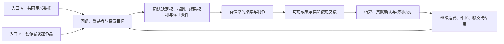
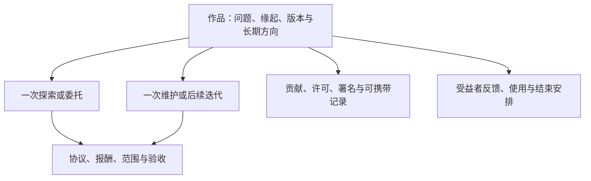

# 产品与首批试点定义

> 文档状态：产品章程与早期验证方案 v0.2 · 2026-11-01
> 阅读入口：[愿作整体方案](/desire-supply-platform-design.md)。本文把整体方案转成可讨论的参与方式、产品要求与验证边界，替代旧版“首版只有委托交易旅程”的战略范围。
> 适用范围：新战略的 R0 方案协作、R1 最小循环及 R2 跨项目验证准备；R 阶段不等同于既有 P0–P5 制度阶段或 G0A/G0B/G1/G2/G3 授权门槛。
> 证据状态：本文定义候选范围，不证明需求、市场、付费意愿或反异化效果已经成立。`TBD` 须在相关活动获准前关闭，规划不得直接转写为已开放服务。
> 授权边界：外部真人研究须先通过 `G0B`，生产纵切开发须先通过 `G1`，真实服务/产品数据/合同与资金须先通过 `G2`；本文不能单独改变 Gate 状态。
> G1 证据路径：`DEC-033` 保留原有构建决定的效力与范围，不自动批准本次新增路径。新的范围、假设和验收须进入决定与要求登记；既有构建证据不替代 G2 所需现实证据。
> 规范依据：[社会契约](/foundations/social-contract.md)、[Foundations 要求目录](/foundations/foundation-requirements.md)、[落地路线图](/foundations/realization-roadmap.md)

## 0. 产品一句话

愿作帮助个人和小型协作团队发现值得解决的问题，掌握从构想到实际使用的创造过程，并获得可持续的报酬、成果权利与社会联系。

早期产品以一项可理解、可使用、可继续发展或妥善结束的**作品**为中心。作品可以是工具、研究、内容、服务方法或共同知识，不要求成立公司，也不要求一个人包办全部工序。委托、探索协议和维护服务是支持作品的不同协作安排；一次订单结束不意味着作品、贡献关系和使用反馈从平台消失。

早期并行验证两条入口：**共同定义的委托**，由需求方、创作者与实际受益者共同明确问题和重要取舍；**创作者发起的作品**，由创作者提出想解决的问题、寻找使用者并形成有边界的探索安排。公共项目与多人共同需求作为后续路径，在资金、代表授权和共同权利规则具备后进入。

两条入口都要回答：创作者是否拥有真实的方向与方法决定权，能否看见成果对谁有用，能否获得合理报酬、保有约定权利，并在不失去基本权利的情况下拒绝或离开。安全、公平的交易是必要基础；成交与交付完成本身不能证明这些目标已经实现。

正式成员共同体、公共金库、所有权结构、宪法治理和合法分支仍须满足各自制度激活条件。作品发起、受益者反馈、成果权利说明和有报酬互助不以成熟共同体先建成为前提；它们可以先在范围清楚、责任明确的安排中验证。

## 1. 首个细分场景

### 1.1 待批准的规划默认值

为使研究和工程讨论有共同边界，在正式选择前采用以下**可撤销规划假设**：

- 入口 A 的需求方：能够提供真实决策人、预算和验收人的小型组织或组织内项目组，并愿意共同定义问题、保留创作者的专业判断；
- 入口 B 的发起者：有明确问题、可接触的候选使用者和有限探索目标的创作者；没有已核验资金时只能准备和研究，不能向他人承诺有偿机会或默认要求无偿试作；
- 创作者：以独立身份承担知识型或数字化交付的专业人员；团队创作者仅在 `DEC-023` 批准后纳入；
- 作品：远程可推进、风险较低、可形成最小可用成果并获得实际使用反馈；探索、制作与维护分别设定时间、预算和结束条件，不把长期维护隐藏在一次交付价格里；
- 服务形态：人工核验问题和角色、付费探索、明确决定权限、有限邀请或直接协作、书面协议、里程碑付款、使用反馈与人工异常处理；
- 区域、语言、币种、行业与价格带：`TBD`；
- 批次人数、项目数、单项目金额和最长周期：由法律、运营、财务和研究共同决定，`TBD`。

两条入口应尽量选择同一窄问题域，以便比较问题来源、决定权、经济成本和持续性。它们不必同时开放或一次实现全部功能：先用合成材料走读，再按获准范围逐项研究和试点。具体行业、批次和资源尚待确定，不得写成已经承诺的招募条件。

### 1.2 选择首个场景的评分标准

候选场景必须同时满足：

| 维度 | 进入条件 | 排除信号 |
| --- | --- | --- |
| 问题强度 | 不解决会产生可描述成本，已有替代做法 | 只对理念感兴趣，没有现实任务 |
| 决策与资金 | 可识别决定权限和探索成本；有偿活动有可核验资金及付款责任 | 用潜在销量或融资承诺代替当前报酬；要求先无偿做出可用成果 |
| 可验收性 | 探索可验收学习证据与停止决定，制作可验收成果，使用反馈另行确认 | 把探索未知强行写成必然成功，或事后随意改变标准 |
| 创作者意愿 | 有一组人主动愿意承担，并能表达边界 | 只能靠高压招募或模糊收益承诺吸引 |
| 创造掌控 | 创作者能参与问题与方法取舍，知道哪些决定需共同确认 | 名义上是主创，实际上只接受逐项指令 |
| 受益联系 | 能接触实际使用者或有有效授权的代表，并确认反馈方式 | 只有付款人意见，无法了解成果实际用途 |
| 风险可控 | 失败可补救，数据与人身风险有限 | 涉及高危实体操作、重大人身/医疗/法律判断 |
| 运营可承载 | 人工团队能在批次上限内处理异常 | 依赖 24/7 响应、跨境复杂支付或大量线下协调 |
| 学习价值 | 能观察问题、重要决定、制作、使用、权利、报酬与后续安排 | 只验证生成速度、成交或满意度，无法解释创造者处境 |

### 1.3 首批明确排除

除非另行完成法律、安全和运营评审，首批试点不接受：

- 医疗诊断或治疗、法律代理、金融投资建议等受监管专业结果；
- 涉及未成年人或无法独立作出有效同意的主体；
- 高危线下施工、运输、照护、人身安全或受控物品；
- 需要大规模处理敏感个人数据、国家秘密、商业核心机密或高风险生物特征的数据项目；
- 可能实质形成雇佣、劳务派遣或长期排他控制，但被包装成项目合作的安排；
- 无明确预算、要求无偿大样稿、公开低价竞标、无限修改或付款取决于模糊满意度的需求；
- 要求平台或创作者代持受监管资金、绕过税务/发票、规避制裁或隐瞒真实受益人的交易；
- 借学校、雇佣、物业、资助或公共服务关系强迫参与的项目；
- 默认要求成立公司、融资、转让全部知识产权或以增长作为唯一验收的项目；
- 平台无法提供必要申诉、退出或失败补救的项目。

## 2. 核心参与者与待办任务

### 2.1 九类协作角色

每个 Demand/Project 必须分别处理以下九类协作角色。角色记录至少包含 `subject`、授权来源、作用域、有效期、是否可转授权、利益冲突和撤回方式；没有记录不能从组织身份、付款、资源贡献或产品权限推断授权。

| 协作角色 | 核心待办任务 | 最担心的失败 | 产品必须提供 |
| --- | --- | --- | --- |
| 问题提出者 | 让一个现实问题得到理解 | 问题被采购语言扭曲 | 问题背景、来源与提出权限 |
| 实际受益者 | 说明谁受影响、什么结果有用 | 被出资者或机构代言 | 独立可见的受益关系与成果反馈 |
| 受益者代表 | 在获授权范围内代表受益者表达 | 机构身份被误当代表授权 | 授权来源、范围、期限、撤回和替代联系 |
| 出资/采购者 | 让资金按合规路径可用 | 付款事实不清或责任转嫁 | 资金义务、合同、状态和对账证据 |
| 资源提供者 | 提供场地、设备、知识、人员、数据或其他非货币资源 | 资源贡献被换成候选、数据或治理控制 | 资源条件、期限、安全、数据/IP、退出和连续性 |
| 需求决策人 | 决定范围、优先级和取舍 | 没有权力却被写成负责人 | 明确权限、决定边界和变更责任 |
| 候选选择者 | 在已接受候选中确认合作者 | 付款或机构身份被误当选择权 | 单独授权、冲突披露、候选作用域和理由 |
| 验收人 | 按约检查交付 | 验收标准被事后改变 | 版本化标准、期限、拒收理由和补救 |
| 项目协调者 | 保持输入、决定和沟通连续 | 成为无边界隐形劳动者或替他人作决定 | 明确职责、升级路径、工作记录和禁止代同意 |

创作者是独立协作主体，不是上述需求侧角色之一；愿作运营者和独立复核者是服务与救济角色，也不因操作系统而获得上述任何项目授权：

| 服务角色 | 责任 | 禁止结果 |
| --- | --- | --- |
| 创作者 | 选择值得做且条件可持续的项目，交付并维护自己的边界 | 不被运营者或需求方默示接受、强迫披露或拖欠 |
| 愿作运营者 | 核验、协调、记录例外和保护流程 | 不成为无审计的隐藏主权者，不替任何一方签字/验收 |
| 独立复核者 | 处理申诉和重大程序争议 | 不参与原决定、项目选择或相关付款操作 |

### 2.2 兼任、冲突与第三方资源安全默认

- 同一主体可以兼任多个协作角色，但必须逐角色记录授权、理由与冲突；一次签字不能默示覆盖全部角色。
- 出资/采购或资源提供不自动产生受益者代表、需求决策、候选选择、验收或数据访问权。
- 问题提出者不自动代表实际受益者；受益者代表缺少可核验授权时，只能记录为待确认意见来源。
- 候选选择者与直接竞争者、导师/上下级或存在重大资金利益者发生冲突时必须回避或接受独立复核。
- 项目协调者可以传递状态，不能替合同当事人、创作者、受益者代表或验收人默示接受。
- 愿作的 Demand reviewer、Safety/Appeal reviewer 和付款核实角色继续遵守运营手册的职责分离，不能因项目角色兼任而绕过。
- **安全默认**：在 `DEC-016` 的伙伴/资源决定获批前，P1 不接受依赖第三方场地、设备、导师、数据、知识、品牌、转介或其他非合同当事人资源才能完成的项目；`资源提供者` 应明确记为 `NONE / NOT APPLICABLE` 并说明依据，不能省略字段。获批后仍须使用版本化伙伴/资源协议、参与者独立同意、替代路径和停摆承接。
- `DEC-023` 未决时只允许单一自然人创作者；`DEC-024` 未决时每个项目只允许一个获批付款方；`DEC-025` 未决时每一合同方只允许一个获授权签字人。不得用通用 Organization 或“团队管理员”绕过这些边界。

## 3. 首版价值主张与可证伪假设

`ASM-*` 是既有假设状态的唯一事实源；`H-PROD-*` 只是在产品语境中的稳定别名，不能独立升级证据等级。下表保留可复用的协作基础假设，不再表示全部产品目标；新增创造路径的假设见 3.2，须登记后才进入真实验证。

### 3.1 继续验证的协作基础

| 产品别名 | Canonical assumption | 假设 | 支持证据 | 反证/停止信号 |
| --- | --- | --- | --- | --- |
| `H-PROD-01` | `ASM-002` | 需求方愿意为需求澄清、可信选择和协作保障付费 | 非条件性价格测试、付费试点或明确采购步骤 | 只愿为最终人力付费，持续拒绝服务费用 |
| `H-PROD-02` | `ASM-003` | 创作者更看重少量合适邀请，而不是大量投标机会 | 实际接受/拒绝理由、比较现有替代方案 | 参与者认为有限邀请反而减少可控机会且不愿继续 |
| `H-PROD-03` | `ASM-004`, `ASM-005` | 双向接受和清晰边界提高完成与再次合作意愿，且拒绝不会被惩罚 | 完整项目复盘、邀请事实与双方独立反馈 | 为成交施压、拒绝后机会下降或再次合作意愿低 |
| `H-PROD-04` | `ASM-013` | 需求澄清能减少范围争议和无偿返工 | 版本化变更、返工原因和补偿事实 | 澄清成本高于减少的风险，或仍普遍事后改口 |
| `H-PROD-05` | `ASM-007` | 可核验资金和付款状态显著提高信任 | 开工前资金确认、按约付款和异常处理记录 | 付款路径不可操作、成本过高或仍需依赖人情催款 |
| `H-PROD-06` | `ASM-006`, `ASM-010` | 人工责任与可解释规则在小规模下可承载且经济上可持续 | 每案工时、积压、错误、覆盖、申诉与直接贡献记录 | 单位服务成本不可承受或运营判断高度不一致 |
| `H-PROD-07` | `ASM-009` | 不以公司化/增长为默认仍可形成有价值成果 | 实际成果路径和受益者确认 | 需求方或资金方持续强迫转向单一商业结果 |

所有假设必须按[研究与证据计划](/foundations/research-and-evidence-plan.md)预先指定证据等级和决策规则。

### 3.2 新增的创造主体性问题

以下为待登记的研究提议，不冒用已有 `ASM-*` 编号或证据等级。R0 要为其补充负责人、方法、样本限制、成本与停止条件。

| 要检验的判断 | 需要观察的事实 | 可能推翻判断的证据 |
| --- | --- | --- |
| 共同定义或自主发起让创作者更能掌握整体 | 谁提出目标、谁作出重要取舍、谁有权拒绝方案变化；创作者能否解释整体 | 只换了“主创”称呼，实际仍按细碎指令执行 |
| 直接使用反馈使劳动与社会效果重新相连 | 使用者参与、实际使用实例、创作者据此作出的迭代或结束决定 | 反馈只是宣传评价，或接触使用者增加大量无偿工作 |
| 付费探索能降低独立创造风险 | 探索报酬、时间上限、失败后的结算、形成的学习与停止证据 | 支出和不确定性仍全部由创作者承担，失败后报酬被追溯取消 |
| 作品可以跨项目积累可持续能力与权利 | 可复用成果、可携带证明、后续维护或收入，以及离开平台后的可用性 | 每次交易都要求全部买断，或成果只有留在平台才可继续使用 |
| 有报酬互助能增强自主而不制造孤立经营压力 | 导师与同行支持、实际成本、分工决定、工作负担与可拒绝性 | 一人承担获客、制作、运营与维护，时间压力反而上升 |

收入、工时、AI 与工具成本、获客和维护成本需要共同观察。作品数量、生成速度、自豪感自报或一次好评不能单独证明主体性提高；不建立个人“反异化分数”。

## 4. 首版主旅程

早期围绕一个完整创造循环建设，两种入口共享同样的权利、安全和经济底线。功能优先级同时看它是否增强创造掌控、受益联系、可持续报酬与退出能力，以及是否减少实际风险和无意义流程成本。不能仅因某项功能不提高委托交易效率，就将其永久排除。

参与者进入任何路径前都须完成适用的身份、授权与知情同意。每一步都必须有取消、超时、冲突、失败、人工接管和申诉语义；需要资金保障的劳动只有在保障成立后开工，后一步不能反向改写前一步的历史事实。

入口 A 继续使用经核验需求、有限且可解释的邀请、无惩罚拒绝、只从已接受者中选择和同版协议。区别是创作者在探索阶段拥有真实的共同定义空间，采购验收与使用者反馈分别记录。

入口 B 允许先表达愿望、问题与候选作品，形成使用者访谈或原型探索的计划；这不等于资金已保障或产品已经有市场。进入有偿探索前，应有明确付款责任、成本上限、成果许可和失败结算安排。没有外部付款方时，个人自主投入可以如实记录，但不得被算成平台创造的付费机会，也不得要求协作者以未来收益替代当前约定报酬。入口 B 不强制伪装成组织采购需求，也不能在当前代码缺少对应路径时宣称已经可用。

### 4.1 作品与交易的关系

“作品”在本方案中是待验证的产品中心，不表示仓库已有相应领域对象或可直接复用既有 `Project` 权限。它应保留问题由谁提出、关键决定由谁作出、贡献如何确认、谁能修改或继续经营、退出后哪些材料可以带走。作品的持续存在不产生免费维护义务；每段新增劳动另行协商。

作品权利按内容和角色区分：署名、展示、复制、修改、复用、商业使用、收益、维护与移交可能由不同主体持有。资助、孵化和提供工具不自动获得这些权利。AI 工具可以外接，关键是使用权限、费用、成果和知识记录不被单一工具锁住；重大判断仍由负责的人确认。

### 4.2 逐笔资金流是产品前置决定

主旅程中的“服务费”“项目资金保障”“创作者付款”“退款/补救”是不同义务，不能共用一个含糊的 `paid` 或 `Funding` 状态。每一笔候选资金流必须按[商业、财务与进入市场计划](/foundations/business-finance-and-go-to-market.md)的 Money Flow 模板登记，并在产品范围中固定：付款人、收款人、合同/义务、金额币种、到期触发、provider/账户、资金法律属性、权威状态源、发票/税费、退款/冲正、对账与失败责任。

候选流至少分别覆盖：研究补偿、付费探索、需求澄清/平台服务费、制作与维护报酬资金保障、向创作者结算、导师或同行支持报酬、退款/冲正以及平台自有补救储备。每项均须有实际成本和付款责任；不预设已获资助，也不预设愿作可以代收、托管、分账或持有参与者资金。

在 `DEC-005`（支付/provider）、`DEC-006`（服务包/价格）和 `DEC-010`（需求澄清收费）均获批准，且适用法律、合同、税务与 provider 证据完成前：

- 不得授权真实 `Funding` 状态、资金操作、provider 集成或对外“资金已保障”表述；
- 不得把平台服务费、创作者报酬、pass-through funds、退款准备或公共/受限资金合并为一种余额；
- 可以使用合成数据设计可撤销接口，但该接口不得成为 G1/G2 的现实资金授权证据。

## 5. P1 产品要求

下表保留既有 P1 产品要求的稳定编号，作为两条新路径共用的协作与安全基础，不代表新战略仅限旧 P1 范围。新增的作品中心和创造掌控要求列在 5.1；正式开发前须补充其能力、用例、权限和证据映射，不能借用旧要求的通过状态。每项仍应在 capability registry 中连接精确 `FND-*`、`CAP-*`、测试、运营和效果证据。

| PRD ID | 要求 | 最低验收 | 主要映射 |
| --- | --- | --- | --- |
| `PRD-P1-001` | 邀请制身份、安全 Session、组织成员与账户/目的同意的独立生命周期 | 登录、轮换、撤销/恢复、组织邀请/移除和账户暂停/关闭均 fail-closed；任何一项变化不级联吞掉付款、数据权或申诉；未同意不得进入对应目的 | `FND-RGT-001`, `FND-DEP-002`, `FND-EXIT-001`, `CAP-S01/S04` |
| `PRD-P1-002` | 版本化创作者意愿、能力、边界和披露 | 私密底线不向无权者泄漏；边界不可被人工覆盖 | `FND-HUM-002`, `CAP-C01` |
| `PRD-P1-003` | 版本化 Demand 与角色授权 | 九类协作角色逐项记录；受益者与代表分离；资源提供者为 `NONE` 时也有依据；兼任、期限和冲突可核验 | `FND-COL-001`, `FND-NOD-001`, `CAP-C02` |
| `PRD-P1-004` | 需求、预算、安全和排除闸门 | 不合格 Demand 不能进入匹配；例外有负责人与复核 | `FND-COL-001/002`, `CAP-C02/03` |
| `PRD-P1-005` | 逐笔资金流与匹配前项目资金状态 | 服务费与项目报酬义务分离；只有依获批 Money Flow、合同和权威来源核验的项目资金 `SECURED` 才能进入邀请；请求状态不冒充到账 | `FND-COL-008`, `CAP-C03/C06` |
| `PRD-P1-006` | 有限、可解释、无竞价邀请 | 每次结果固定规则和最小必要事实；无公开低价竞标或付费排名 | `FND-COL-002/004`, `CAP-C04` |
| `PRD-P1-007` | 双向接受与选择 | 未接受者不能被选择；拒绝、撤回和超时有明确状态且不作为惩罚特征 | `FND-COL-004`, `CAP-C04` |
| `PRD-P1-008` | 同版协议、里程碑和必要签字 | 所有必要方接受同一版本后才开工；历史版本不可覆盖 | `FND-COL-003`, `CAP-C05` |
| `PRD-P1-009` | 范围、时间、报酬和成果路径变更 | 任何实质变更都形成新版本、影响说明与必要方重新接受 | `FND-COL-003/010`, `CAP-C05` |
| `PRD-P1-010` | 交付、拒收、验收与受益者确认 | 合同验收和受益者成果确认分开；理由、期限与补救可见 | `FND-HUM-003`, `CAP-C05` |
| `PRD-P1-011` | 付款、退款、冲正和对账 | 最终状态来自权威支付/财务证据；未知结果不重复支付或谎报成功 | `FND-COL-008`, `CAP-C06` |
| `PRD-P1-012` | 举报、争议、临时保护和申诉入口 | 最小范围、自动到期、理由、原决定人与复核人分离 | `FND-COL-009`, `CAP-C08` |
| `PRD-P1-013` | 最小数据权入口 | 用户能知情、访问、更正、导出并提出删除/限制请求；例外可理解 | `FND-RGT-001..005`, `CAP-S04` |
| `PRD-P1-014` | 情境化结果与评价 | 财务事实、自报观察、关系意愿和成果路径分开；不生成全局人格分 | `FND-REP-001`, `CAP-C09` |
| `PRD-P1-015` | 运营决定与敏感操作审计 | actor、权限、理由、规则版本、冲突、复核和结果可追踪 | `FND-SEP-001`, `CAP-S03` |
| `PRD-P1-016` | 故障时人工连续性 | 系统关闭或伙伴退出不吞掉协议、应付报酬、数据权、申诉和必要证据 | `FND-DEP-002`, `CAP-S05/I12` |
| `PRD-P1-017` | 权限化、无障碍产品壳与辅助参与路径 | 浏览器、键盘、屏幕阅读器、清晰语言和获批辅助路径可完成同等关键旅程；BFF 实时校验权限，代理有范围、期限、撤回和真实 actor | `FND-EQU-003`, `FND-NOD-006`, `CAP-S06` |
| `PRD-P1-018` | 必要事务通知、投递事实与备用路径 | 规则/协议/决定/付款/权利/安全等必要通知使用正确版本和最小内容；失败、延迟、重复、备用通道及期限恢复可证，失败不冒充知情 | `FND-RUL-001`, `FND-SAF-004`, `CAP-S07` |
| `PRD-P1-019` | 项目消息、文件、扫描、版本、权限和数据权 | 对象绑定 Project/AgreementVersion；未通过扫描、越权、撤权、保留/删除或第三方权利冲突时 fail-closed，并提供导出、纠正与申诉 | `FND-RGT-004`, `FND-CTR-002`, `CAP-C07` |

19 项 PRD 与 25 个逐项验收用例的精确映射，以[要求与能力登记册](/foundations/requirements-capability-registry.md)和[软件交付章程](/foundations/software-delivery-charter.md)为准；本表不得用较短描述降低其异常、权限、数据权或救济验收。

### 5.1 新战略的最小产品增量

以下是待登记要求，不是已实现能力，也不自动分配现有 `PRD-P1-*` 的验收结果：

| 产品增量 | 最低可验证行为 | 复用的原则与基础 |
| --- | --- | --- |
| 创作者发起入口 | 可以从问题和意愿提出作品，明确探索上限、候选使用者和资金未知项 | `FND-HUM-002/003`；Profile 与角色授权 |
| 作品全貌 | 在一个连续记录中理解问题、版本、重要决定、贡献、反馈和后续方向 | `FND-HUM-003`；Project/Agreement/Outcome 的适用事实 |
| 决定权限说明 | 创作者、付款方、受益者与协作者能理解各自可决定及须共同确认的事项 | `FND-COL-003`, `FND-NOD-001`；版本化协议 |
| 有报酬探索与互助 | 探索失败仍按约结算；导师、评议和协调时间有预算与停止条件 | `FND-COL-002/006/008`；资金核验与公共劳动记录 |
| 使用反馈与继续选择 | 合同验收之外能看见实际使用；继续、修改或结束均有理由与责任 | `FND-HUM-003`, `FND-COL-010`；受益者确认 |
| 权利说明与携带 | 清楚展示可署名、展示、复用、修改及导出的范围；换工具或离开后进行可用性验证 | `FND-RGT-*`, `FND-EXIT-*`；第三方权利与保留规则 |

首轮可先由受控模板和人工服务验证，只有反复出现的需要才转成专门软件。不会因“先人工”而省略报酬、同意、数据权或申诉。

## 6. 关键状态与不可变条件

以下是既有委托与有偿协作的状态约束，继续适用于新路径中相应的活动。创作者发起作品不自动成为 `Demand` 或 `MATCHABLE`；作品与探索所需的新状态要另行设计，不能绕过既有资金、同意与权限约束。

### 6.1 Demand

`DRAFT → SUBMITTED → REVIEWED → FUNDING_PENDING → MATCHABLE → MATCHING → SELECTED / CLOSED`

- `CANCELLED/REJECTED/CLOSED` 不得仅因字段仍齐全而重新匹配；
- 任何实质修改形成新版本并重新经过受影响闸门；
- “有预算描述”不等于“资金已保障”。

### 6.2 Invitation 与 Selection

`INVITED → ACCEPTED / DECLINED / WITHDRAWN / EXPIRED`

- Selection 只能引用同一 MatchRun 中已 `ACCEPTED` 的候选；
- 拒绝不自动改变未来资格或曝光；
- 需求方选择意图与最终完成选择分开，后者必须满足资金、冲突和接受条件。

### 6.3 Agreement、Milestone 与 Payment

- Project shell 可先建立，但未完成必要 Agreement 接受不得开工；
- 需要保障的 Milestone 未 `SECURED` 不得开工；
- `PAYMENT_REQUESTED/PROCESSING` 不等于 `PAID`；
- provider 结果未知时保持未知并进入调查，不以超时推断成功或失败；
- 争议或安全限制只冻结与风险直接相关的最小范围。

## 7. 产品非目标

R1 不以实现以下事项为目标；其中涉及正式制度权力或真实服务授权的部分继续服从既有条件：

- 开放注册与无限自助发布；
- 海量搜索、公开榜单、低价投标、竞价排名或付费曝光；
- 全局声誉分、等级、贡献币或自动成员晋级；
- AI 自动选择、自动处罚、自动争议裁决或自动资格判断；
- 复杂社交 feed、注意力增长、连续签到或以活跃为目标的游戏化；
- 正式成员议会、公共金库、成员经济权益、宪法表决或 fork；
- 多国家、多币种、多支付商和大规模线下节点；
- 自动生成具有法律效力的专业判断；
- 未经验证的全行业通用市场。

也不建设全能 AI 开发工具、不把“一人承担所有岗位”设为成功标准、不承诺创业成功或基本生活保障。外部工具、既有专业团队和合作组织可以成为支持方式，但每项资源仍有清楚权限与费用。

新增请求须说明它怎样增强完整创造循环或降低已观察风险，并重新通过范围评审。公共基金未激活，不妨碍在批准的单项合同和预算内为探索、评议或指导付费；反过来，这些单项支出也不能被称为已经运行的公共金库。

## 8. 服务与产品的边界

首批价值很大一部分由人提供，必须诚实标注：

| 由软件负责 | 由人负责 | 由外部权威负责 |
| --- | --- | --- |
| 版本、权限、作品与协作事实连接、流程闸门、提醒、最小审计和状态显示 | 问题真实性、重要创作取舍、使用反馈解释、冲突、例外、争议、复杂验收与公共价值判断 | 法律实体、合同效力、银行/支付结果、税务、外部身份/服务资格 |

自动化只在重复证据显示判断稳定、可解释、可申诉且伤害可控后引入。减少人工时间不是自动化的充分理由。

## 9. 产品验收与试点停止条件

### 9.1 继续进入封闭试点的最低产品证据

- 相关参与者都能复述问题、决定权限、收费与报酬、成果权利和未承诺事项；
- 两条候选入口都完成合成走读，拟实际开放的每条路径都有不依赖产品界面的人工连续性演练；
- 每个 `PRD-P1-*` 都有正常、拒绝、故障、申诉和退出中适用的验收；
- 新增创造要求已完成映射，不能用旧 P1 用例通过替代其验收；
- 运营者能够在不修改数据库的情况下处理所有允许的人工决定；
- 参与者能看到关键规则、版本、责任人和下一步；
- 合成数据演练没有未关闭的 Critical 安全、付款、权限或历史完整性问题。

候选规模是同一低风险领域内 4–6 项作品，两种入口各 2–3 项；在相关活动获准后，用约 8–12 周观察最小完整循环，随后安排 30／90 天使用与维护跟踪。这是可调整的资源估算起点，不是招募承诺、工期承诺或足以证明因果的统计样本。预算按探索、制作、支持、运营、维护和风险储备等工作包据实报价；资金未落实时不得启动依赖该资金的劳动。

结果分开报告：交易伤害是否减少、创造决定权是否增加、成果是否被使用、经济安排是否可持续、材料与权利能否携带。观察实际决定及权利事实，同时保留参与者叙事、拒绝和失败案例。平台不能把满意度或成交率改善直接解释为“消除了异化”。

### 9.2 立即暂停新增项目的信号

- 无法确认决策权、资金来源或必要签字；
- 发生未授权数据披露、私密报酬推断或跨项目数据混用；
- 付款状态无法收敛、应付报酬无责任人或损失超过批准上限；
- 拒绝、举报或申诉后出现机会报复迹象；
- 原决定人与申诉复核无法分离；
- 需求持续依赖无偿试作、无限变更或关系性强迫；
- 运营队列超过批准容量，导致关键权利或付款超时；
- 参与者无法理解协议、数据处理或退出后果；
- 真实结果显示服务只增加流程负担，没有降低风险或建立更好关系。

新路径还须检查：创作者只是名义主导；探索成本被转成无偿劳动；使用反馈变成宣传任务；AI 与经营负担使实际报酬或工作时间恶化；平台或资助者未经协商取得成果控制。出现这些信号时，先停止扩张、调整具体安排，不用“热爱创造”要求参与者忍受。

暂停不等于立即终止现有义务。已开始项目的报酬、申诉、数据权和善后必须继续可达。

## 10. 尚待产品决定

以下事项必须进入[决定登记册](/foundations/risk-decision-and-assumption-register.md)，不能由设计师或开发者默认：

- `DEC-001`：首个行业/问题类型、地域、语言、币种、辖区以及双方招募/排除标准；
- `DEC-002`：批次上限、单项目金额、最长周期、里程碑数量与总损失上限；
- `DEC-010`：需求澄清是单独付费服务、平台费用的一部分还是补贴；
- `DEC-005`：资金保障采用直接预付、持牌第三方托管、分期支付或其他合法路径，以及 KYC/KYB 和最小身份要求；
- `DEC-026`：何种成果、数据、行业或主体风险触发更高审查、附加合同或排除；
- `DEC-009`：九类协作角色的必填/兼任、受益者代表授权和成果确认边界；
- `DEC-016`：是否以及何时允许第三方资源/伙伴进入 P1；批准前保持禁止第三方资源的安全默认；
- `DEC-023`、`DEC-024`、`DEC-025`：首版是否分别支持团队创作者、多个付款方和多个必要签字方，以及各自责任、付款、授权与失效语义；
- `DEC-006`：价格、服务费、补贴和例外如何呈现、批准与到期；
- `DEC-022`：何种证据足以从邀请制转向更开放的准入或公开上线。

R0 另须登记本次新增范围的决定，不在本文虚构新的批准编号：两种入口的首个问题域与分批顺序；作品与既有项目的关系；发起者、受益者和资助者的决定权限；付费探索和互助的责任及资金来源；署名、展示、复用、维护与携带的默认协商项；新增假设、用例和停止条件。`DEC-023/024/025` 未关闭时，团队、多付款方、多签字人仍不启用；合作资源另受 `DEC-016` 约束。

产品团队的近期交付是让上述问题成为外部伙伴可以理解、参与修订、分别承诺资源的具体方案，再按证据与授权推进研究、服务和软件。
