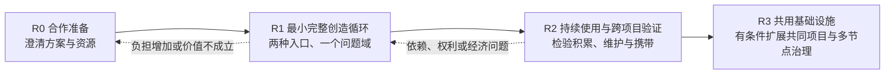
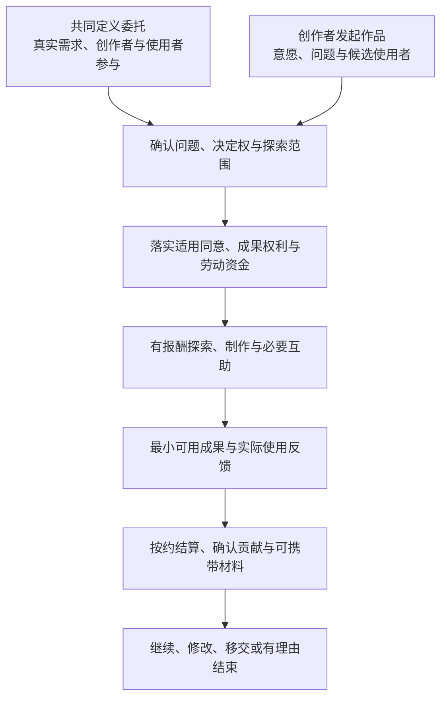

# Foundations 落地路线图

> 文档状态：战略与验证路线 v0.2 · 2026-11-01。与[愿作整体方案](/desire-supply-platform-design.md)和[产品与首批试点定义](/foundations/product-and-pilot-definition.md)共同使用，替代旧版“先完成唯一委托交易旅程，再考虑创造与共同体”的战略排序。
> 本文中的 R0–R3 是新的合作与验证阶段；既有 P0–P5 的制度激活条件、G0A/G0B/G1/G2/G3 的活动授权和历史批准事实继续有效。新方案不使运行环境、真实服务权限或能力状态自动升级。
> 时间、作品数量和合作方式均为可调整的候选，不是招募、资金、开发排期或效果承诺。当前能力须核对主报告的代码审查依据与相应运行文档；[2026-08-09 实现差距审计](/foundations/implementation-gap-assessment.md)仅作为历史记录。

## 0. 路线图的核心选择

愿作要验证的是：个人与小型协作团队能否在现实经济条件下，掌握从问题、决定、制作到实际使用与后续安排的完整创造过程。公平、安全的交易继续提供基础保障；创作者发起、共同定义问题、可见的受益联系和成果权利从早期就进入验证。

两条早期入口是共同定义的委托与创作者发起的作品。它们共享安全和经济底线，但不强行使用相同的发起流程。多人共同需求和公共项目在资金、代表授权、资源责任和共同权利能够承担后加入。

阶段之间按证据推进，可以缩小、修改、保持人工或停止。不能用完成更多模块、生成更多成果或形成更大交易额代替参与者处境的改善。

## 1. 全程必须遵守的交付原则

### 1.1 以完整创造循环为交付单位

每项作品都要回答：谁提出问题，谁实际受益，谁作重要决定，谁承担哪些劳动与成本，谁持有哪些成果权利，以及继续、移交或结束如何安排。委托协议、探索任务和维护服务是循环中的不同活动，不把作品等同于一次订单。

### 1.2 创造掌控与基本保护同时验证

身份、同意、资金、数据权、争议和恢复不能后补；问题发起、决定权限、使用反馈和成果可携带也不能无限留在远期愿景。早期可以用受控模板、人工服务和外部工具验证，软件优先支持反复出现且容易出错的环节。

### 1.3 有报酬的探索与互助

把探索、导师、同行评议、协调和维护列为明确工作包，写清付款责任、范围与停止条件。探索未产生预期产品，不自动取消已经按约完成劳动的报酬。个人自主投入与平台促成的付费机会分别记录，不用潜在销售或融资替代当前约定报酬。

### 1.4 每次扩权都同时交付限权

管理、评审、守护或代表权限同时具备作用域、期限、利益冲突、审计、撤回、申诉和接替机制。受益者、付款方、资源方、项目决策者与候选选择者逐角色授权；提供资金或场地不自动获得成果和成员的控制权。

### 1.5 法律事实、技术能力与效果分别验收

成员权益、许可、核心资产和章程效力由真实主体及有效文件建立，软件仅执行获授权流程。能力状态继续按 `DESIGN → CONTRACT → DOMAIN → MEMORY → POSTGRES → HTTP → COMPOSED → ENABLED → OPERATED → EFFECTIVE` 分层记录。设计、测试通过、生产启用和实际改善不能互相替代。

### 1.6 指标不把人总分化

保留收入、成本、拒绝、决定、使用、权利和负担等不同事实及参与者叙事，不建立“使命总分”或“自豪感排名”。AI 可以辅助整理、制作和验证，不能替人决定付款、资格、争议或共同体权力。

## 2. R0：合作准备

建议用 2–4 周形成可评议、可报价、可分别承担责任的方案。实际时间取决于伙伴意愿和准备情况；阅读本报告、讨论方案和表达兴趣都不等于已经加入试点或承诺资金。

### 2.1 本阶段要形成的结果

- **一个窄问题域**：两条入口尽量处于同一低风险领域，能形成可用成果并接触真实使用者；行业、地域、语言和币种仍须明确选择。
- **两份创造循环样例**：共同定义委托与创作者发起各一份，使用合成或已有获授权材料走读问题、决定、探索、使用、报酬和退出。
- **参与与决定权限说明**：明确创作者、实际受益者、付款方、资源方、协调者和独立复核者；不把一个组织身份当作全部授权。
- **按工作包估算的资源表**：分别估算研究、探索、制作、导师与评议、运营、工具、维护、风险和善后成本；记录已确认、候选和缺口，不预设资金已经获得。
- **成果与数据权利草案**：署名、展示、修改、复用、商业使用、收益、维护与携带分别协商，明确第三方资料限制与退出后的可用性。
- **研究与试点证据方案**：为新增主体性假设补充负责人、观察方法、反证和停止条件；更新相关 `FND → CAP → PRD/UC → 证据` 映射。
- **当前能力清单**：复核实际代码与装配，把可复用能力、需要人工承接的步骤和新能力分开，避免把旧审计断点当作当前事实。

### 2.2 可与伙伴讨论的资源

| 合作贡献 | 具体可交付内容 | 应先明确的边界 |
| --- | --- | --- |
| 问题与使用场景 | 真实问题背景、现有做法、适合访谈和反馈的使用者来源 | 接触个人前通过相应研究授权；机构不能代替个人同意 |
| 探索与制作预算 | 分阶段、有限额的工作包与明确付款责任 | 不以未来融资或销售替代已约定报酬，不附带未经协商的成果占有 |
| 专业互助 | 导师、同行评议、设计与维护支持 | 时间、报酬、利益冲突和可更换安排 |
| 工具或场地 | 账户、算力、空间、设备等有限支持 | 使用成本、数据用途、可迁移性和资源退出后的承接 |
| 评估与保障 | 研究、财务、合同、隐私、争议及独立复核能力 | 明确责任实体与独立性，不把资源赞助转成决定权 |

伙伴资源的实际使用仍受 `DEC-016` 和适用协议约束；外部真人研究先过 `G0B`，真实服务、产品数据、合同与资金先过 `G2`。本阶段可以准备这些条件，不能以“合作讨论”名义提前开展未获准活动。

### 2.3 进入下一阶段的条件

首个问题域、拟开放入口、工作包、资金责任、角色授权、作品权利和停止安排已具体化；每个拟发生的研究或服务活动满足其门槛；两条入口都完成合成走读，实际开放的路径具有人工连续性与适用验收。条件不足时继续准备或缩小范围，不把补齐条件的压力转给创作者。

## 3. R1：最小完整创造循环

在相关活动获准后，候选安排是约 8–12 周，在同一低风险领域先验证 3–4 项共同定义委托；独立探索资源和使用反馈条件落实后，再加入最多 2 项创作者发起作品，总上限 6 项。按[商业可行性分析](/foundations/commercial-feasibility-and-stakeholder-choices.md)区分交易验证与探索支持，不要求两种入口均分或凑满数量。这是可调整的容量假设，不构成招募承诺，也不是足以证明因果的统计样本。

### 3.1 两种入口，一组共同底线

共同定义的委托继续复用需求审核、有限邀请、明确接受、同版协议和里程碑保障。创作者发起入口不必先伪装为组织采购需求；但转为有偿协作时同样要落实付款责任、保障和必要同意。无外部付款方的个人自主投入必须如实标记，不能计入平台促成的付费成果。

在 `DEC-023/024/025` 分别关闭之前，团队创作者、多付款方、多签字人仍保持原有未启用边界。两条路径的最小循环可以先按获准的简单主体关系验证，不能用“作品共同体”绕过这些限制。

### 3.2 这一轮最少要提供什么

| 能力 | 最少可用安排 | 判断是否值得软件化 |
| --- | --- | --- |
| 作品全貌 | 连续的问题、版本、决定、贡献、使用与后续记录 | 信息分散已导致理解、权限或维护错误 |
| 创作者发起 | 可表达“我想做什么”、寻找反馈、说明探索成本与未知项 | 有重复发生且不能由既有入口合理表达的发起过程 |
| 决定权限 | 创作者、使用者、付款方理解各自可决定和须共同确认的事项 | 决定反复越界或版本无法追踪 |
| 付费探索与互助 | 工作包、预算、约定产出、失败结算、导师和评议安排 | 报酬、范围与支持排期反复失真 |
| 受益者反馈 | 从真实使用获取观察，和合同验收分开 | 反馈无法形成后续决定，或依赖大量重复协调 |
| 权利与携带 | 可理解的许可、署名、展示、复用、维护和导出清单 | 导出后不能使用，或换工具必须重新建立全部记录 |

AI 生产工具可以接入既有工具；重点是帮助理解与验证成果，保留重要选择、费用和材料的可迁移性。R1 不建设通用 AI IDE，不要求在愿作内监控全部创作过程，也不要求所有创造活动都变成可计算指标。

### 3.3 需要同时闭合的协作基础

已有 `PRD-P1-001..019` 和相应异常用例继续适用。复用前核验固定版本上的身份、权限、Profile、Demand、Matching、Trust 等实际能力；项目、协议、里程碑、文件、通知、付款、数据权和结果路径是否可用，须逐项以公开入口、持久化、恢复与人工流程证明。

- 未接受者不能被选择，拒绝不成为未来机会的惩罚特征。
- 实质范围变化重新确认时间、报酬与必要权利；协议历史不得静默改写。
- 匹配前 `DEMAND_VERSION` Funding 与开工前 `MILESTONE` Funding 的适用语义继续分开；新探索资金流须独立登记，不能偷用既有状态。
- 请求、处理中、未知结果与已付款分开；财务事实来自批准的权威来源与对账。
- 暂停、争议和退出不无关级联吞掉应付报酬、数据权、贡献证明或申诉。
- 每条开放路径都具备适用的正常、拒绝、故障、冲突、申诉与退出验收。

### 3.4 如何判断这一轮有价值

每项作品形成一份共同核对的证据包，至少包括：创作者实际影响了哪些重要决定；受益者如何参与并使用成果；探索、制作、支持和维护的实际成本；约定与实际报酬；可带走或继续使用的材料和权利；继续或结束的理由；未预期负担与不同意见。

同时使用[使命衡量与学习计划](/foundations/mission-measurement-and-learning-plan.md)中的报酬、拒绝、边界、资金、成果路径、公共劳动及安全指标。新增创造掌控问题在 R0 预注册，不用旧指标的通过替代它们。满意度、复作意愿与自豪感可以提供线索，但不冒充客观控制权或社会层面的去异化结论。

若关键劳动没有保障、无偿劳动增加、创作者只有名义决定权、实际使用者不可见、工具和平台依赖加深，或运营负担无法承担，暂停扩张并修改安排。即使作品完成或交易增长，也不能跳过这些反证。

## 4. R2：持续使用与跨项目验证

候选观察期为后续 3–6 个月，并对适合跟踪的作品安排 30／90 天复访。跟踪需要单独说明用途、同意与成本；未回应不能推断为成功或失败，停止维护也可以是合理结果。

### 4.1 这一阶段回答什么

- 作品是否真的持续使用，哪些问题已解决、哪些新问题出现？
- 创作者能否把一次经验带入下一次作品，获得可复用方法、贡献证明、关系和合理后续收入？
- 维护是否有责任人和预算，是否发生交付后的无限免费劳动？
- 人们能否选择继续、暂停、更换工具或离开平台，而不失去约定权利？
- 对一个客户、模型供应商、平台或资源伙伴的依赖是否下降，还是换了一种集中依赖？
- 导师与同行支持是否改善能力和工作负担，而不是形成新的资格垄断？

### 4.2 再逐步扩展的能力

优先支持跨项目的作品历史与可携带贡献凭证、持续服务与维护安排、选择性披露、工具替换和接收演练。项目知识是否可以公开、复用或商业化由有效许可和相关权利人决定，不默认把参与记录变成平台资产。

只有在实际需要及相应决定批准后，才加入临时团队、多个资金来源和共同需求。共同需求先从明确受益者、有限人数和单一可问责协调方式开始；不得把承诺兴趣算成已落实资金，不以模糊的未来共享收益替代当前劳动安排。

### 4.3 进入下一阶段的条件

至少有可复核的跨项目实践，支持创造掌控、经济持续和权利可用性确有改善；失败与退出同样进入结论。公共劳动、共享工具或规则冲突反复出现，且已有足够多利益位置不同的人承担责任，才考虑把这些关系制度化。没有这些证据时继续小规模运行，不以社区活跃度代替共同体形成。

## 5. R3：共用基础设施与多节点治理

本阶段不预设日期。它由真实共享需求、持续公共劳动、可承担预算和多方责任触发，不能因为路线图列出就一次性开发。

### 5.1 可以逐步形成的安排

- **公共知识与工具**：许可、维护者、预算、复用证据和停止维护后的承接方式。
- **有报酬的公共劳动**：指导、评议、调解、知识整理和规则维护分别记录；不把全部运营成本都包装成公共贡献。
- **成员与有限任期职责**：参与交易、正式成员资格、公共职务、账户和数据权保持独立，低强度参与者不丧失基本权利。
- **公共与共同需求**：受益者、代表、付款方和资源方分别授权，公共目的变化、成果专有化或收益安排取得受影响权利人的必要同意。
- **分层治理与公共资金**：先从有限事项和小额预算开始，建立提案、审议、反对意见、冲突回避、执行及复盘，不让投票直接操作资金或生产权限。
- **多个协作节点**：可以连接学校、社区、企业或社会组织，支持多重归属与跨节点申诉，节点停止时仍能承接材料、报酬和必要权利。
- **使命资产与真实所有权**：在法律与组织条件成熟后，形成成员受益和控制关系、核心资产保护、资本约束及合法分支能力。

### 5.2 从现在就开始的限权

成熟治理可以渐进，创始期的权力约束不能等待：登记品牌、代码、域名、协议、数据及资金的真实控制人；披露融资、债务、大客户、资助、工具与资源附带条件；禁止未经必要授权处置核心资产或购买成员权力；预留善后能力；让成员和非成员都能获得公平服务。

共同所有不由数据库字段产生，公共金库不由一个拨款页面产生，合法分支不等于复制代码。相应现实主体、权利文件、资金来源、独立复核与接收演练必须成立。

## 6. 与既有 P0–P5 和 Gate 的关系

R 阶段回答“接下来优先学习和协作什么”；P 阶段保留制度能力的激活语义；Gate 回答“某种活动当前是否获准”。三者不能互相替代，也不按编号机械对应。

| 既有范围 | 继续保留的含义 | 新路线中的处理 |
| --- | --- | --- |
| P0 事实基线与试点安全 | 证据来源、数据、权利、责任和临时资本护栏 | 从 R0 起持续执行，不复用过期审计结论 |
| P1 窄协作闭环 | 既有合同、报酬、同意、拒绝、申诉和恢复的最低保护 | 作为 R1 两条入口的共同基础；旧“唯一委托旅程”不再是新战略的范围上限，新增路径另行完成设计与批准 |
| P2 权利、安全与可靠运营 | 跨域数据权、独立申诉、可靠付款、文件与通知、供应商和伙伴退出连续性 | 开放活动前已有最低保护，R1/R2 随规模提高可靠性；不能等到 R2 才提供基本权利 |
| P3 成员、贡献与开放机会 | 有稳定跨项目责任后，形成独立公民资格、可携带贡献、有任期职务和新人路径 | 在 R2/R3 证据成熟后按需激活；小额有报酬指导可以先按批准合同进行 |
| P4 公共经济与分层治理 | 有多元正式主体、真实公共劳动、可审计资金及可靠执行后，扩大治理事项与公共预算 | R3 条件式能力；不以早期顾问讨论冒充成员共同治理 |
| P5 使命资产、所有权与合法分支 | 真实法律与财务安排、核心资产权利、多方批准、退出及接收演练 | R3 条件式能力；成熟结构后置，临时限权从 R0 就落实 |

外部真人访谈、观察和研究招募先适用 `G0B`，研究补偿按获准研究路径处理；它们不产生产品账号、商业合同或资金授权。正式生产纵切适用 `G1`，真实服务、生产产品数据、合同和资金适用 `G2`，公开或扩张范围继续核对 `G3` 与相关决定。`DEC-033` 只保留其原有构建证据路径，不替代新增路径批准或现实市场证据。具体状态与签字条件以[启动决策入口](/foundations/readiness-and-start-decision.md)、[风险、决定与假设登记册](/foundations/risk-decision-and-assumption-register.md)及有效批准记录为准。

## 7. 依赖关系与不可倒置顺序

| 拟激活能力 | 必须先具备 | 避免的失败 |
| --- | --- | --- |
| 有偿探索、制作与互助 | 明确义务、资金责任、报酬与停止安排、适用同意和救济 | 用热情或未来收益承担全部风险 |
| 作品与跨项目记录 | 作品和项目权限区分、来源与贡献确认、有效许可、选择性披露 | 将共同成果、客户资料或他人贡献错误据为己有 |
| 可携带凭证与材料 | 来源验证、纠错与撤销、第三方权利筛选、接收使用演练 | 下载成功被误报为可用的退出能力 |
| 团队与共同需求 | `DEC-023/024/025` 适用批准，分工、付款、授权、冲突与退出清楚 | 由“团队管理员”替所有人同意或吞并权利 |
| 伙伴资源与正式节点 | `DEC-016` 及协议、资源条件、独立同意、停摆承接；正式节点另满足成员与治理条件 | 提供支持变成总体控制或事实强迫 |
| 正式成员资格与公共职务 | 稳定贡献证据、公开规则、多元复核、补偿、任期、申诉 | 早期活跃者成为永久权力阶层 |
| 公共金库与规则治理 | 多元主体、可审计资金、职责分离、独立发布、回滚与复盘 | 投票包装运营意志，或直接越权操作资金和生产配置 |
| 成员经济权益与合法分支 | 法律权利、资产清单、资本约束、第三方权利和接收演练 | 软件声称共同所有，现实控制关系毫无改变 |

这些能力继续参考 `CAP-C05/C07/C09`、`CAP-S04` 以及 `CAP-I01..12` 的适用设计，但能力地图不是已经完成的产品清单。新增作品能力要先完成映射，不能直接将原有某个上下文改名后算作实现。

## 8. 每轮评审与停止决定

每轮报告同时提供事实、解释与决定，至少回答：

1. 开放了什么范围，哪些参与、资金和权利已经获得有效授权？
2. 哪些代码与人工能力真实运行，哪些仍是设计或未启用实现？
3. 创作者实际决定了什么，谁真正使用了成果，哪些重要意见改变了作品？
4. 收入与全部必要成本怎样分布，探索、互助和维护是否得到合理安排？
5. 是否增加了自主、成长与关系，又给谁增加了时间、风险或依赖？
6. 拒绝、争议、失败、退出和反对意见如何改变判断？
7. 哪些材料与权利能够携带，实际接收或换工具是否成功？
8. 下一步是继续、修改、缩小、保持人工、停止，还是具备条件扩大某项制度？

未经授权的数据披露、无保障劳动、无法收敛的付款、报复、独立申诉不可达等事件仍按既有保护规则立即处置，不能被平均结果抵消。停止新增活动不等于取消已承担的报酬、维护、数据权与善后义务。

这份路线图所要求的进展，是每一轮都更清楚：创造者掌握了哪些实际权利，哪些成本被公平承担，哪些共同资源值得持续建设，以及哪些依赖需要主动减少。
