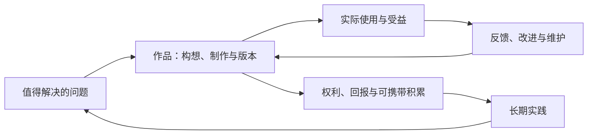
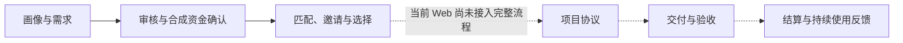

# 核心概念

本页解释[整体方案报告](/desire-supply-platform-design.md)使用的概念，并区分新的产品方向与仓库已经实现的对象。概念出现于文档，不意味着相应页面、持久化、权限和真实服务已经接通。

## 方案以什么为中心

| 概念 | 含义 | 与当前实现的关系 |
| --- | --- | --- |
| **问题与使用者** | 谁遇到什么困难、为什么值得解决、改善如何被观察；使用者、付款者和验收者可以不同 | Demand 已能表达问题、目标受益者类型和预期结果；持续使用者关系与结果反馈仍待建设 |
| **作品** | 围绕问题形成、可以被使用并具有作者和权利安排的成果，包括软件、内容、工具、知识及服务 | 新方案的中心对象；不能将现有需求单、匹配记录或一次文件上传直接视为完整作品系统 |
| **长期实践** | 一个人或小团队围绕领域、问题或群体持续创造与维护的活动，可以包含多个作品和合作 | 新方案概念；不等同于持续接单、公司注册或平台留存 |
| **完整创造** | 对问题、关键选择、成果、使用反馈和后续去向具有理解与实质影响 | 不要求一个人包办所有工序；可以分工、使用 AI、协作或移交 |
| **成果权利** | 对署名、使用、修改、复用、收益、授权和退出的具体安排，并尊重他人权利 | 需要协议、资产与授权记录及实际执行；不能只靠作品展示或贡献徽章实现 |
| **可持续支持** | 让人能够承担合理创造风险的收入、资源、服务和关系 | 需记录成本、条件、期限与独立性；不承诺无条件盈利，也不以支持换取全面控制 |

图示是目标闭环。现有 Web 已有部分前期协作能力，尚未实现这条完整链路。

## 三种创造来源

| 来源 | 起点 | 需要解决的核心问题 |
| --- | --- | --- |
| **委托** | 个人或组织提出问题并承担约定付款 | 需求是否真实、范围是否合理、创作者能否参与判断、验收与报酬是否受保障 |
| **创作者发起** | 创作者提出自己愿意长期投入的问题或作品构想 | 能否接触使用者、验证价值、找到早期支持，并保有产品方向和成果权利 |
| **共同或公共创造** | 多个参与者共同提出问题，或为共享用途创造 | 谁参与决策、如何确认贡献、采用何种许可、谁支持公共劳动与长期维护 |

三种来源可以转化或并存。例如，委托中产生的通用工具可在各方同意和明确许可后继续发展；公共成果也可以获得有偿维护。路径转换应重新确认相关人的权利和责任。

## 人的角色可以变化

**创作者**提出、制作或维护成果，也可能成为其他作品的使用者和委托方。**使用者或受益者**提供真实情境和使用反馈，不必等同付款者。**委托方或支持者**提供资金、输入或资源，但不能据此购买成员的全部自主权。**协作者**共同承担创造；**运营、评审、调解与公共维护者**承担服务和问责责任，其劳动也需要支持。

这些是方案中的关系角色。当前代码仍采用受控职责：个人工作区 `CREATOR`，组织工作区 `DEMAND_OWNER/ORG_ADMIN`，以及平台审核、财务、安全和申诉职责。一个人可以具有多个获授权角色，但当前个人创作者路径尚不能直接代表新的作品发起和共同治理能力。

## 当前软件对象如何理解

| 已有对象或路径 | 当前作用 | 不能由此推断的能力 |
| --- | --- | --- |
| **Creator Profile** | 版本化记录兴趣、能力、时间、合作偏好、私密报酬边界与限制；支持发布、暂停和恢复等操作 | 不是完整作品档案、可携带贡献证明或公共声誉系统 |
| **Demand** | 记录需求、范围、验收、预算、风险等，并进入审核、合成资金确认和匹配 | 需求完成匹配，不等于作品已完成、使用者已受益或资金已支付 |
| **MatchingAttempt / MatchRun** | 保留匹配轮次、输入与规则依据，支持运营审核候选 | 规则可解释，不自动证明机会分配公平或创作者掌握了平台规则 |
| **Invitation / Selection** | 创作者查看披露后接受、拒绝或撤回；授权需求方选择已接受者 | 接受邀请不是签署最终协议，选择完成不是开工、交付或结算 |
| **Trust / Appeal** | 已有当前限定对象和角色范围内的举报处理与申诉流程 | 不能据模块存在推断所有创作者与所有争议都已有可达救济 |
| **CLI 的 Recommendation / Decision / Outcome** | 本地工具保存推荐快照、人工决定和结果记录，用于运营复盘 | 运营录入的结果不等于平台执行了合同、支付或真实项目管理 |

`platform/` + `web/` 的已接入操作仍限于 `INTERNAL_SANDBOX`；`mvp/` 是独立的本地运营工具；`demo/` 是刷新可重置的合成制度演练。阅读任何“完整流程”时，应先确认它属于哪条路径。

## 证据、试点与衡量

**试点**是范围、参与方式、资金、风险和学习目标明确的一次验证，不因被写入计划就已经启动。真实参与者与真实合同、资金的条件见[启动决策入口](/foundations/readiness-and-start-decision.md)。

**事实、解释和决定**需要分别记录：已经发生了什么，我们如何理解它，以及由谁据此作出什么选择。合成演练可以验证流程和软件，不能证明真实收入、使用价值或自主性改善。

**使命成效**需要同时看创造过程的参与、成果权利、实际使用反馈、可持续收入、合作关系与退出选择。完成数量、成交金额、使用时长或自报热情都不能单独代表成功。具体口径与证据要求见[使命衡量与学习计划](/foundations/mission-measurement-and-learning-plan.md)。

CLI 的 `BLOCKER/WARNING/QUESTION`、预算 `GREEN/YELLOW/RED` 等是该工具的校验与运营概念，不能直接替代平台的权限、资金状态或真实业务事实；细节见[匹配、预算与决策](/architecture/matching-and-budget.md)。
