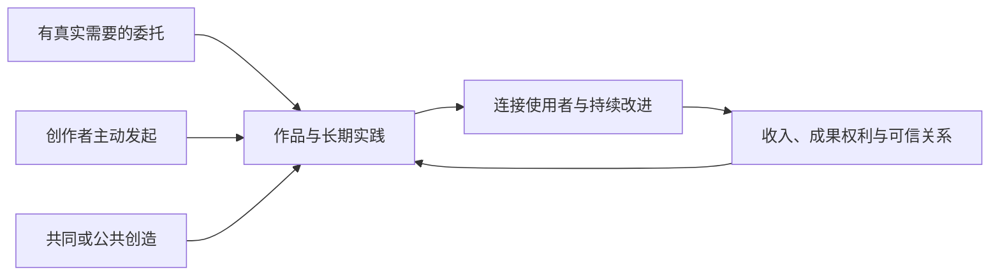

# 项目介绍

愿作帮助个人和小团队发现值得解决的问题，掌握从构想到实际使用的创造过程，并获得可持续收入、成果权利和社会联系。完整方案、实施取舍与合作资源需求见[《愿作整体方案报告：让人重新掌握完整创造》](/desire-supply-platform-design.md)。

## 为什么需要愿作

大模型使个人和小团队有机会完成过去需要更大组织分工完成的创造，但“能做出来”还不足以让人掌握自己的劳动。一个人仍可能只接到别人切分的任务，看不到实际使用者，不参与产品方向，也无法积累作品权利、稳定收入和可信关系。

愿作希望推动的变化是：人能够选择值得投入的问题，理解并影响全过程，看到成果如何被使用，并保有继续、协作、转向或退出的实际选择。自豪感可能由此产生，但平台不能用“热爱创造”替代合理报酬，也不能要求每个人独自承担一家公司的全部劳动和风险。

## 平台围绕什么组织

方案将**作品与长期实践**作为中心。作品可以是软件、内容、工具、研究、知识成果或服务；长期实践指围绕一个问题、群体或领域持续创造、维护和积累能力。二者都可以由个人或小团队承担。

三种来源共享对人的尊重，但组织方式可以不同。委托需要明确的范围、验收和付款；创作者发起需要问题验证、早期使用者和支持；共同或公共创造需要透明的贡献、许可、维护责任与资源安排。平台应容纳一次完成、持续服务、开放共享和适时停止，而不把所有成果都推向公司化。

## 如何判断它是否有用

| 需要改善的关系 | 我们希望看到的变化 |
| --- | --- |
| 人与劳动过程 | 创作者参与问题定义、关键决策和迭代，能够理解整体而不必亲手完成每道工序 |
| 人与成果 | 作者和贡献清楚，权利、授权、维护与退出安排明确，可携带合理范围内的积累 |
| 人与使用者 | 真实使用反馈回到创作者，付款验收和实际受益分别被看见 |
| 人与生计 | 收入及其成本、风险可理解，拒绝或暂停不会成为失去全部机会与支持的惩罚 |
| 人与共同体 | 协作、指导和公共劳动得到支持，参与者有影响规则及提出申诉的路径 |

这些是需要检验的目标，不是 AI 或平台能够自动兑现的结果。我们既关注成果，也关注创造者是否有更多余裕、能力和选择。

## 当前已经做到哪里

仓库有两条实际软件路径：`platform/` + `web/` 是受邀内部多角色工作台，已有账号、画像、需求、审核、合成资金确认、匹配邀请与选择，以及限定角色范围的信任安全和申诉；`mvp/` 是本地运营 CLI，支持资料校验、预算检查、解释性匹配和留痕报告。

工作台固定为 `INTERNAL_SANDBOX`，只用于内部账号与合成资料的演练。当前 Web 尚未接入协议、交付验收与结算的完整流程，作品持续经营、成果权利和新共同体机制也仍待建设。`demo/` 虽可演练更完整的制度旅程，但其合成状态不能作为真实交付或现实效果的证据。当前运行边界见[内部试运行平台](/architecture/internal-pilot-platform.md)和[启动决策入口](/foundations/readiness-and-start-decision.md)。

新的规划将在这些基础上改变产品中心，并逐步验证完整创造的支持方式。参与合作前，可继续阅读[核心概念](/guide/core-concepts.md)及[整体方案报告](/desire-supply-platform-design.md)中的阶段安排和资源需求。
